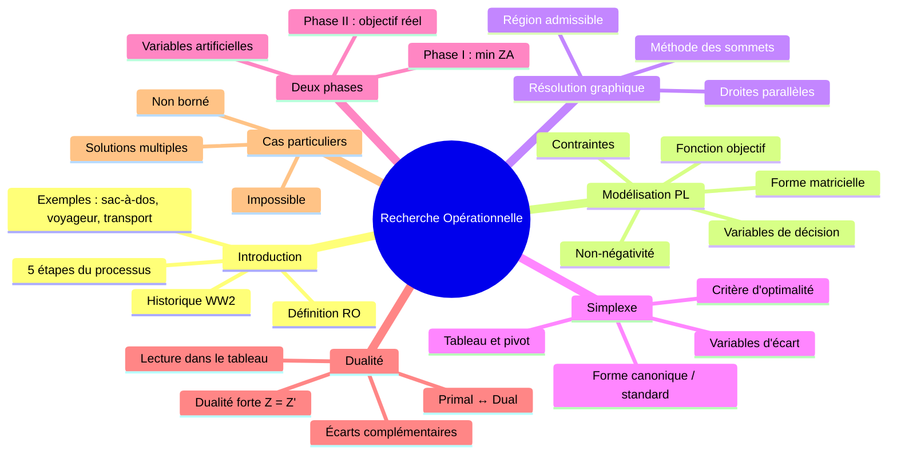
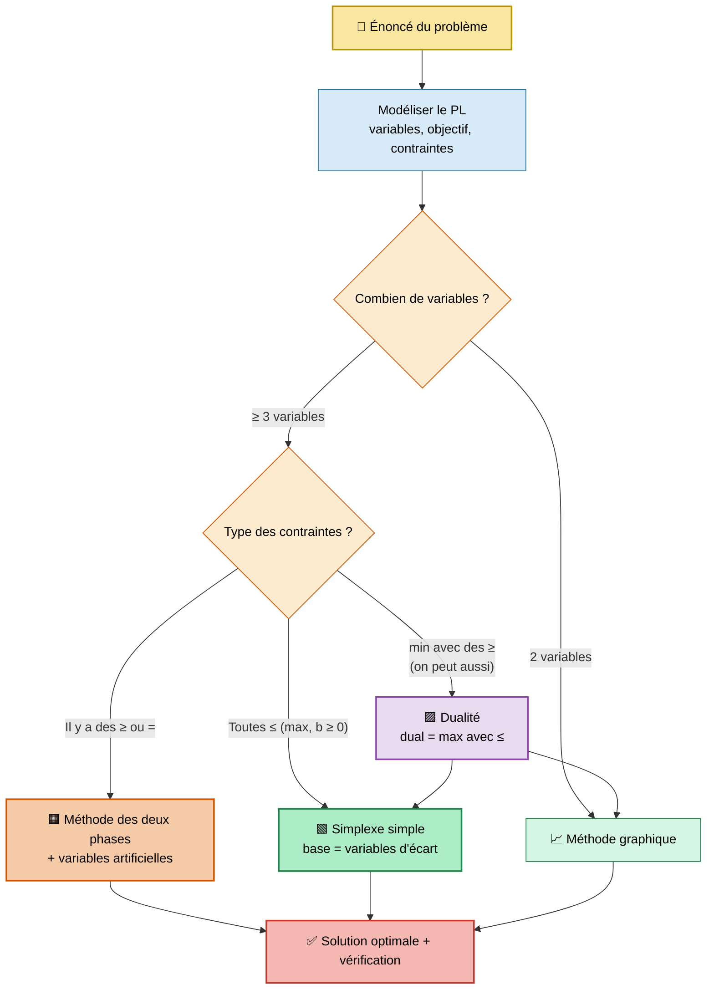

# 🎯 Recherche Opérationnelle — Objectif 20/20

> [!examen] Examen : **vendredi 20 novembre 2026**
> Ce vault contient **tout** le cours de Prof. K. EL KIMAKH (EMSI Marrakech, 4IIR) réorganisé, expliqué et corrigé pas à pas.
> Le **TP corrigé** (méthode des deux phases) est le **modèle de l'exercice d'examen** → c'est la priorité n°1.

---

## 🗺️ Carte du cours

## 🧭 Quelle méthode utiliser ? (arbre de décision)

---

## 📚 1 — Cours (dans l'ordre)

| # | Chapitre | Importance examen |
|---|---|---|
| 1 | [[01 - Introduction à la RO]] | ⭐ (questions de cours) |
| 2 | [[02 - Modélisation d'un PL]] | ⭐⭐⭐ (toujours demandé) |
| 3 | [[03 - Résolution graphique]] | ⭐⭐⭐ |
| 4 | [[04 - Formes canonique et standard]] | ⭐⭐⭐ (1ʳᵉ étape de tout exercice) |
| 5 | [[05 - Méthode du Simplexe]] | ⭐⭐⭐⭐ |
| 6 | [[06 - Méthode des deux phases]] | ⭐⭐⭐⭐⭐ (= TP) |
| 7 | [[07 - Dualité]] | ⭐⭐⭐⭐ (même PL que le TP dans le cours !) |
| 8 | [[08 - Cas particuliers]] | ⭐⭐⭐ |

## ✍️ 2 — TP et exercices

- [[10 - TP corrigé - Deux phases (modèle d'examen)]] ← **commence ici après le cours**
- [[11 - Exercices du cours corrigés]] (mélange, pilules, P1/P2, déchets, …)
- [[12 - Exercices d'entraînement type examen]] (nouveaux exercices + solutions cachées)

## 🧠 3 — Révision

- [[20 - Fiche résumé]] — tout le cours sur une page
- [[21 - Pièges et conventions des tableaux]] — ce qui fait perdre des points
- [[22 - Modèle de rédaction pour l'examen]] — comment présenter sa copie
- [[23 - Questions de cours (flashcards)]] — auto-test théorie

## 🏋️ 4 — Exercices (salle d'entraînement)

- [[Exercices]] ← **3 exercices corrigés par partie** (intro, modélisation, graphique, forme standard, simplexe, deux phases, dualité, cas particuliers) + un **examen blanc** de 2 h sur 20

---

## 📅 Plan de révision sur 2 jours

> [!methode] Mercredi 18 — Comprendre
> - [ ] Lire [[01 - Introduction à la RO]] et [[02 - Modélisation d'un PL]] (45 min)
> - [ ] [[03 - Résolution graphique]] + refaire l'exercice des pilules **sur papier** (1 h)
> - [ ] [[04 - Formes canonique et standard]] + [[05 - Méthode du Simplexe]] (1 h 30)
> - [ ] Refaire le simplexe de l'exercice P1/P2 **sans regarder** (45 min)
> - [ ] [[06 - Méthode des deux phases]] (1 h)
> - [ ] [[10 - TP corrigé - Deux phases (modèle d'examen)]] : le lire, puis le **refaire seul** sur papier (1 h)

> [!examen] Jeudi 19 — S'entraîner comme à l'examen
> - [ ] [[07 - Dualité]] + [[08 - Cas particuliers]] (1 h 30)
> - [ ] Exercice des déchets (deux phases, max) chronométré : 30 min
> - [ ] [[12 - Exercices d'entraînement type examen]] : exercices 1 → 4 chronométrés
> - [ ] [[Ex 9 - Examen blanc]] en conditions réelles (2 h)
> - [ ] Relire [[21 - Pièges et conventions des tableaux]]
> - [ ] Le soir : [[20 - Fiche résumé]] + [[23 - Questions de cours (flashcards)]]

> [!piege] Le jour J
> Vérifie **toujours** ta solution finale en la remplaçant dans les contraintes (comme dans le TP, partie 5). Ça prend 1 minute et ça détecte 90 % des erreurs de calcul.

> [!info] Note sur le programme
> Le plan général du cours mentionne aussi la **théorie des graphes** et les **plus courts chemins**, mais aucun support n'est fourni dans les dossiers `cour/` et `TP/`. Ce vault couvre donc la **programmation linéaire** (le contenu des PDF). Demande à ton prof si les graphes sont au programme de vendredi.
