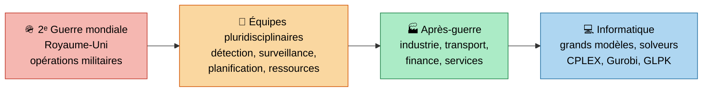
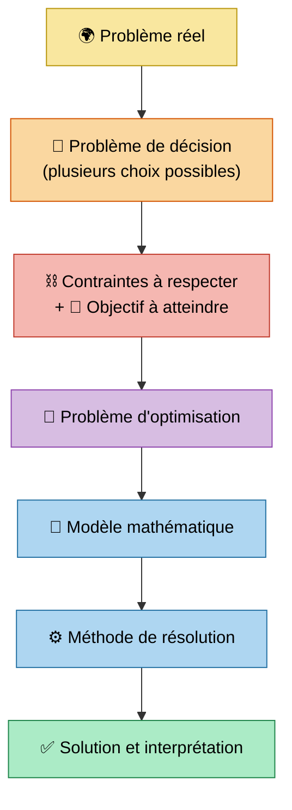
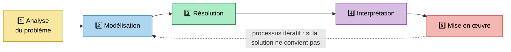
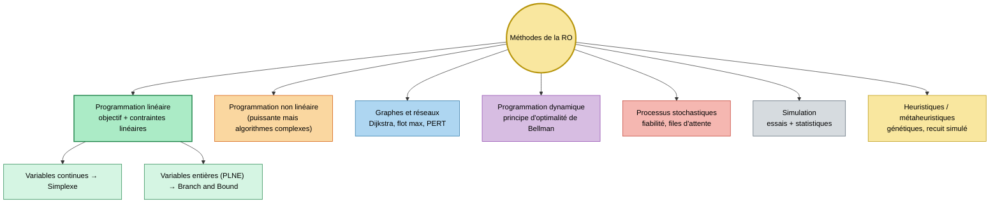

# 01 — Introduction à la Recherche Opérationnelle

⬅️ [[00 - Accueil]] · ➡️ [[02 - Modélisation d'un PL]]

---

## 1. Définition

> [!definition] Recherche Opérationnelle (RO)
> La RO est une **discipline scientifique** qui utilise des **méthodes mathématiques**, des **modèles** et des **algorithmes** pour **analyser des problèmes de décision** et rechercher une **solution optimale ou satisfaisante** sous un ensemble de **contraintes**.

Elle répond à des questions comme :
- Quelle décision faut-il prendre ?
- Comment utiliser au mieux des **ressources limitées** ?
- Quel chemin choisir dans un réseau ?
- Comment **minimiser** un coût, une distance, un temps ?
- Comment **maximiser** une capacité, un débit, un profit ?

> [!astuce] À retenir en une phrase
> RO = **modélisation mathématique** + **algorithmique** + **informatique**.
> La modélisation formule le problème, l'algorithmique fixe la méthode, l'informatique fournit la puissance de calcul.

## 2. Historique

- Le terme **« Recherche Opérationnelle »** apparaît pendant la **Seconde Guerre mondiale au Royaume-Uni** (opérations militaires).
- Des **équipes pluridisciplinaires** étudient la détection, la surveillance, la planification et l'utilisation optimale des ressources.
- Après la guerre → transfert vers **l'industrie, le transport, la finance, les services**.
- Avec l'**informatique** : problèmes plus complexes, **très grand nombre de variables et de contraintes**, calculs rapides, **solveurs commerciaux**.

## 3. Domaines d'application

| Domaine | Exemples |
|---|---|
| Transport & logistique | tournées, acheminement |
| Production & stocks | quantités à produire |
| Finance & économie | portefeuille, budget |
| Santé | gestion hospitalière |
| Énergie, télécoms | dimensionnement |
| **Informatique & réseaux** | routage, plus court chemin, débit max, affectation de serveurs, ordonnancement des tâches, mémoire/énergie, conception de réseaux |
| Planification & ordonnancement | emplois du temps |

## 4. Du problème réel au problème d'optimisation

> [!definition] Problème d'optimisation
> Rechercher **la meilleure solution** parmi un **ensemble de solutions réalisables**.
> - **Maximisation** (max Z) : profit, débit, capacité, performance.
> - **Minimisation** (min Z) : coût, distance, temps d'exécution, latence.

## 5. Les 5 étapes du processus d'optimisation

| Étape | Contenu |
|---|---|
| **1. Analyse** | Comprendre le système : objectifs, décisions, ressources, contraintes, données, relations. *Mauvaise compréhension ⇒ mauvais modèle.* |
| **2. Modélisation** | Traduire en équations : **variables de décision**, **contraintes**, **fonction objectif Z**. |
| **3. Résolution** | **Algorithmes exacts** (garantissent l'optimum), **métaheuristiques** (problèmes complexes), **solveurs** (CPLEX, Gurobi, GLPK). Le choix dépend de la **complexité**. |
| **4. Interprétation** | Traduire en décisions concrètes ; cohérence avec le terrain ; **analyse de sensibilité** ; discussion avec les décideurs. |
| **5. Mise en œuvre** | Intégrer au système réel : interface utilisateur, formation des équipes, suivi/mise à jour du modèle. |

> [!piege] Phrase clé du cours
> « L'optimisation est un **processus itératif**. Si la solution finale ne convient pas, il faut souvent **revoir la modélisation**. »

## 6. Exemples classiques de problèmes

| Problème | Contraintes | Objectif |
|---|---|---|
| **Routage réseau** (A → B) | capacités des liaisons, routeurs | min coût / distance / latence |
| **Allocation de ressources** (CPU, mémoire, stockage, serveurs) | ressources utilisées ≤ disponibles | max performance ou min coût |
| **Conception de réseau** | coût et capacité des liaisons | min coût total avec tous les sites connectés |
| **Ordonnancement** | durées, précédences, ressources | min temps total / respect des délais |
| **Sac-à-dos (Knapsack)** | poids total ≤ capacité | **max** valeur totale |
| **Voyageur de commerce** | chaque ville **une seule fois**, cycle | **min** distance totale |
| **Transport** | capacités usines, demandes centres | **min** coût de transport |

## 7. Principales méthodes de résolution

> [!examen] Questions de cours possibles
> - Définir la RO.
> - Citer les 5 étapes du processus d'optimisation.
> - Différence entre **méthode exacte** et **métaheuristique** (la 2ᵉ ne garantit pas l'optimum mais trouve vite de bonnes solutions, utile pour les problèmes **NP-difficiles** comme le voyageur de commerce).
> - Quand utilise-t-on Branch and Bound ? → variables **entières** (PLNE).
> - Programmation dynamique → principe d'optimalité de **Bellman**, très efficace pour le **sac-à-dos**.

➡️ Suite : [[02 - Modélisation d'un PL]]
