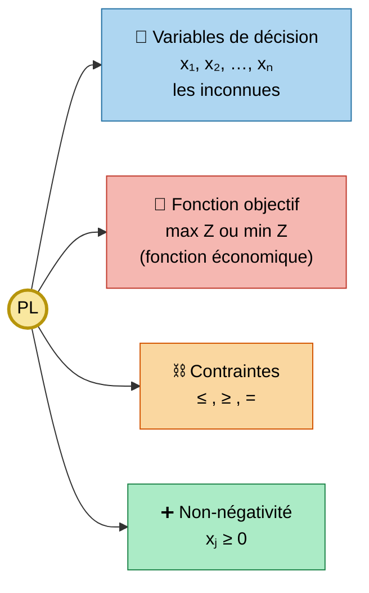

# 02 — Modélisation d'un Programme Linéaire (PL)

⬅️ [[01 - Introduction à la RO]] · ➡️ [[03 - Résolution graphique]] · 🏠 [[00 - Accueil]]

---

## 1. Définition

> [!definition] Programmation linéaire
> Branche des mathématiques appliquées et de l'optimisation dont l'objectif est de **maximiser ou minimiser une fonction linéaire** de plusieurs variables, sous un ensemble de **contraintes linéaires** (équations ou inéquations).

> [!definition] « Linéaire » signifie
> - la **fonction objectif** est linéaire ;
> - les **contraintes** sont linéaires.
>
> ✅ $Z = 5x_1 + 3x_2 + 7x_3$ est linéaire.
> ❌ $Z = x_1 x_2 + 3x_3$ **n'est pas** linéaire (produit $x_1 x_2$). Idem pour $x_1^2$, $\sqrt{x_1}$, $\frac{1}{x_1}$…

> [!astuce] Modélisation
> **Modélisation = traduction d'un problème réel en modèle mathématique.**
> Tout modèle constitue une **simplification** de la réalité.

## 2. Les 4 ingrédients d'un PL

> [!info] Vocabulaire
> La fonction $Z$ s'appelle indifféremment : **fonction objectif**, **fonction économique**, **fonction à optimiser**.

## 3. Les 5 étapes de la modélisation

> [!methode] Méthode (à suivre dans l'ordre sur ta copie)
> 1. **Identifier les variables de décision** (« On pose $x_1$ = … »), avec leur **unité**.
> 2. **Déterminer la fonction objectif** (max d'un profit / min d'un coût).
> 3. **Traduire les limitations en contraintes** (une ligne de tableau de données = une contrainte).
> 4. **Ajouter les contraintes de non-négativité** $x_j \ge 0$.
> 5. **Vérifier la cohérence** du modèle (unités, sens des inégalités).

### Comment choisir le sens de l'inégalité ?

| Mot dans l'énoncé | Inégalité |
|---|---|
| « au plus », « ne dépasse pas », « disponible », « capacité », « plafonné à », « ne peut pas acheter plus de » | **≤** |
| « au moins », « minimum », « besoin de », « doit satisfaire », « obligation de traiter au minimum » | **≥** |
| « exactement », « égal à », « la totalité » | **=** |

## 4. Exemple de maximisation (cours)

> [!exercice] Énoncé
> Une entreprise fabrique deux produits A et B. A rapporte **50 DH**, B rapporte **60 DH**. Elle dispose de **8 h machine**, **10 kg** de matière p et **36 kg** de matière q.
>
> | | A | B | Disponible |
> |---|---|---|---|
> | Machine (h) | 1 | 2 | 8 |
> | Matière p (kg) | 2 | 2 | 10 |
> | Matière q (kg) | 9 | 4 | 36 |

**Étape 1 :** $x_1$ = quantité de A à fabriquer, $x_2$ = quantité de B.
**Étape 2 :** bénéfice $Z = 50x_1 + 60x_2$ → on maximise.
**Étapes 3-4 :**

$$
\begin{cases}
\max Z = 50x_1 + 60x_2 \\
x_1 + 2x_2 \le 8 & \text{(machine)}\\
2x_1 + 2x_2 \le 10 & \text{(matière p)}\\
9x_1 + 4x_2 \le 36 & \text{(matière q)}\\
x_1 \ge 0,\ x_2 \ge 0
\end{cases}
$$

> [!astuce] Lire un tableau de données
> **Chaque ligne** (ressource) donne **une contrainte** : on multiplie la consommation unitaire par la variable de la colonne, on additionne, et on compare au disponible.

> [!definition] Interprétation
> Toute solution $(x_1, x_2)$ doit respecter **simultanément** toutes les contraintes. La solution recherchée est celle qui donne la **meilleure valeur de Z** parmi les **solutions réalisables**.

## 5. Exemple de minimisation (cours : nutrition)

Deux aliments P (20 DH) et Q (40 DH). $x_1$ = quantité de P, $x_2$ = quantité de Q.

$$
\begin{cases}
\min Z = 20x_1 + 40x_2 \\
2x_1 + x_2 \ge 16\\
x_1 + x_2 \ge 12\\
x_1 + 3x_2 \ge 18\\
x_1,\ x_2 \ge 0
\end{cases}
$$

Les besoins nutritionnels sont des **minimums** ⇒ contraintes **≥**.

## 6. Modèle général et forme matricielle

$$
\begin{cases}
\max Z = c_1x_1 + c_2x_2 + \dots + c_nx_n\\
a_{11}x_1 + a_{12}x_2 + \dots + a_{1n}x_n \le b_1\\
\quad\vdots\\
a_{m1}x_1 + a_{m2}x_2 + \dots + a_{mn}x_n \le b_m\\
x_j \ge 0
\end{cases}
\qquad\Longleftrightarrow\qquad
(PL)\begin{cases}
\max Z = C^T X\\
AX \le B\\
X \ge 0
\end{cases}
$$

avec

$$
X=\begin{pmatrix}x_1\\ \vdots\\ x_n\end{pmatrix},\quad
C=\begin{pmatrix}c_1\\ \vdots\\ c_n\end{pmatrix},\quad
B=\begin{pmatrix}b_1\\ \vdots\\ b_m\end{pmatrix},\quad
A=\begin{pmatrix}a_{11}&\cdots&a_{1n}\\ \vdots&&\vdots\\ a_{m1}&\cdots&a_{mn}\end{pmatrix}
$$

| Symbole | Taille | Signification |
|---|---|---|
| $X$ | $n \times 1$ | variables de décision |
| $C$ | $n \times 1$ | coefficients de l'objectif (profits/coûts) |
| $A$ | $m \times n$ | matrice des coefficients des contraintes (**1 ligne = 1 contrainte**) |
| $B$ | $m \times 1$ | seconds membres (disponibilités/besoins) |

> [!examen] Pourquoi c'est important ?
> Cette écriture matricielle sert à construire le **dual** : on transpose $A$ et on échange $B$ et $C$ → voir [[07 - Dualité]].

## 7. Exercice du cours (mélange X / Y)

> [!exercice] Énoncé
> Une entreprise a besoin d'un mélange X et Y. Elle ne peut pas acheter **plus de 22 kg de X** et **14 kg de Y**. X coûte **20 DH**, Y coûte **40 DH**.
> X contient 2 kg de A, 1 kg de B, 1 kg de C. Y contient 1 kg de A, 1 kg de B, 3 kg de C.
> Il faut **au moins** 14 kg de A, 12 kg de B, 18 kg de C. Quelle quantité acheter au moindre coût ?

> [!solution]- Solution (clique pour afficher)
> $x$ = kg de X achetés, $y$ = kg de Y achetés.
> $$
> \begin{cases}
> \min Z = 20x + 40y\\
> 2x + y \ge 14 & (A)\\
> x + y \ge 12 & (B)\\
> x + 3y \ge 18 & (C)\\
> x \le 22,\quad y \le 14 & \text{(achats max)}\\
> x \ge 0,\ y \ge 0
> \end{cases}
> $$
> Résolution graphique → [[11 - Exercices du cours corrigés#Exercice 1 — Mélange X et Y (graphique)]] : optimum **(9 ; 3)**, **Z = 300 DH**.

## 8. Domaines d'application de la PL

Production (quantités), agriculture (cultures), nutrition (panier à coût minimal), transport/logistique, industrie (machines, matières), gestion (coûts/bénéfices), **informatique** : routage et bande passante, cloud/data centers (machines virtuelles), ordonnancement des tâches (scheduling).

➡️ Suite : [[03 - Résolution graphique]]
