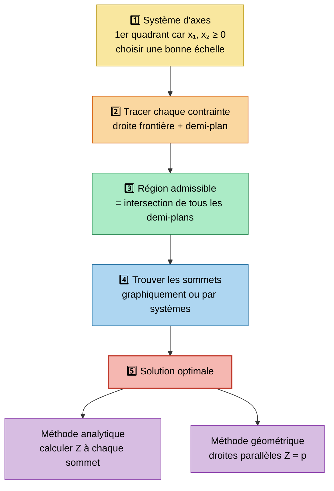

# 03 — Résolution graphique

⬅️ [[02 - Modélisation d'un PL]] · ➡️ [[04 - Formes canonique et standard]] · 🏠 [[00 - Accueil]]

---

> [!definition] Quand l'utiliser ?
> La méthode graphique est adaptée aux PL à **deux variables de décision** (plan $(x_1, x_2)$).
> Trois variables : possible mais en 3D. Au-delà → [[05 - Méthode du Simplexe]].

## 1. Les étapes

### Étape 1 — Axes
À cause de $x_1 \ge 0$ et $x_2 \ge 0$ → on travaille **uniquement dans le premier quadrant**.
Choisir l'échelle pour que **toutes** les contraintes soient visibles et que les valeurs importantes soient lisibles.

### Étape 2 — Tracer les contraintes
Chaque contrainte $a x_1 + b x_2 \le c$ définit un **demi-plan** limité par la **droite frontière** $a x_1 + b x_2 = c$.

> [!methode] Tracer une droite rapidement : les 2 intersections avec les axes
> - $x_1 = 0 \Rightarrow x_2 = c/b$
> - $x_2 = 0 \Rightarrow x_1 = c/a$
>
> **Quel côté garder ?** On teste l'origine $O(0,0)$ :
> - si $0 \le c$ est vrai → on garde le côté **qui contient O** ;
> - sinon → l'autre côté.
>
> (Typiquement : **≤ ⇒ côté de l'origine**, **≥ ⇒ côté opposé à l'origine**, quand $c > 0$.)

### Étape 3 — Région admissible
> [!definition] Région admissible
> Aussi appelée **domaine réalisable**, **zone de solution**, **ensemble des solutions réalisables** : c'est **l'intersection de tous les demi-plans**. Elle contient toutes les solutions qui satisfont **simultanément** toutes les contraintes.

> [!piege] La région admissible peut être
> - **vide** → problème impossible ;
> - **bornée** → l'optimum existe toujours ;
> - **non bornée** → l'optimum peut être infini (voir [[08 - Cas particuliers]]).

### Étapes 4-5 — Trouver l'optimum

> [!theoreme] Théorème fondamental
> Si la région admissible est **bornée et non vide** :
> - la solution optimale **existe toujours** ;
> - elle se trouve **obligatoirement sur au moins un sommet** (point extrême) de la région.
>
> Plus généralement : si un PL admet une solution optimale, il existe une solution optimale qui est une **solution réalisable de base**, correspondant à un **sommet**.

**Méthode analytique (recensement des sommets)** : 1) trouver tous les sommets ; 2) calculer Z en chacun ; 3) prendre le meilleur.

**Méthode géométrique (droites parallèles)** : tracer les droites de niveau $\Delta_p : c_1x_1 + c_2x_2 = p$ (toutes **parallèles**) et les déplacer :
- **max** → vers le point **le plus éloigné** de l'origine ;
- **min** → vers le point **le plus proche** de l'origine,

jusqu'au dernier sommet touché.

## 2. Exemple complet du cours

$$
(P)\begin{cases}
\max Z = 3x_1 + 5x_2\\
x_1 \le 4 & (\Delta_1)\\
2x_2 \le 12 & (\Delta_2)\\
3x_1 + 2x_2 \le 18 & (\Delta_3)\\
x_1, x_2 \ge 0
\end{cases}
$$

**Droites frontières :**

| Droite | Équation | Points de tracé | Demi-plan gardé |
|---|---|---|---|
| $\Delta_1$ | $x_1 = 4$ | verticale en $x_1=4$ | à **gauche** |
| $\Delta_2$ | $2x_2 = 12 \iff x_2 = 6$ | horizontale en $x_2 = 6$ | en **dessous** |
| $\Delta_3$ | $3x_1 + 2x_2 = 18$ | $(0 ; 9)$ et $(6 ; 0)$ | côté de l'origine |

![[graph-cours-max3x1-5x2.svg]]

**Sommets** : $O(0,0)$, $A(0,6)$, $B(2,6)$, $C(4,3)$, $D(4,0)$.

> [!methode] Calcul d'un sommet = intersection de 2 droites
> $B$ : $\begin{cases}2x_2 = 12\\ 3x_1 + 2x_2 = 18\end{cases} \Rightarrow x_2 = 6,\ 3x_1 = 18 - 12 = 6 \Rightarrow x_1 = 2$. Donc $B = (2, 6)$.
> $C$ : $\begin{cases}x_1 = 4\\ 3x_1 + 2x_2 = 18\end{cases} \Rightarrow 2x_2 = 6 \Rightarrow x_2 = 3$. Donc $C = (4, 3)$.

**Méthode analytique :**

| Sommet | $Z = 3x_1 + 5x_2$ |
|---|---|
| $A(0,6)$ | $0 + 30 = 30$ |
| $B(2,6)$ | $6 + 30 = $ 36 ✅ |
| $C(4,3)$ | $12 + 15 = 27$ |
| $D(4,0)$ | $12 + 0 = 12$ |

**Méthode géométrique :** on trace $3x_1 + 5x_2 = p$ pour $p = 10, 20, 36$… La dernière droite qui touche la région passe par $B(2,6)$ avec $p = 36$ (droite violette en pointillés sur le graphe).

> [!solution] Conclusion
> $x_1^* = 2$, $x_2^* = 6$, $Z_{\max} = 36$.

## 3. Exercice du cours - les pilules

> [!exercice] Énoncé
> Petite pilule : 2 grains d'aspirine, 5 de bicarbonate, 1 de codéine.
> Grande pilule : 1 grain d'aspirine, 8 de bicarbonate, 6 de codéine.
> Le malade a besoin d'**au moins** 12 grains d'aspirine, 74 de bicarbonate, 24 de codéine. Minimiser le **nombre de pilules**.

> [!solution]- Solution complète (clique)
> $x_1$ = nombre de petites pilules, $x_2$ = nombre de grandes pilules.
> $$
> \begin{cases}
> \min Z = x_1 + x_2\\
> 2x_1 + x_2 \ge 12 & \text{(aspirine)}\\
> 5x_1 + 8x_2 \ge 74 & \text{(bicarbonate)}\\
> x_1 + 6x_2 \ge 24 & \text{(codéine)}\\
> x_1, x_2 \ge 0
> \end{cases}
> $$
> ![[graph-pilules.svg]]
> Région **non bornée** (vers le haut/droite) mais on **minimise** → l'optimum existe (côté origine).
>
> | Sommet | Calcul | $Z$ |
> |---|---|---|
> | $(0 ; 12)$ | axe $x_2$ ∩ aspirine | 12 |
> | $(2 ; 8)$ | $2x_1+x_2=12$ ∩ $5x_1+8x_2=74$ : $x_2 = 12-2x_1 \Rightarrow 5x_1 + 96 - 16x_1 = 74 \Rightarrow x_1 = 2$ | **10** ✅ |
> | $(126/11 ; 23/11)$ | bicarbonate ∩ codéine | ≈ 13,5 |
> | $(24 ; 0)$ | codéine ∩ axe $x_1$ | 24 |
>
> **Optimum : 2 petites + 8 grandes = 10 pilules.**
> Vérif : aspirine $4+8=12$ ✓, bicarbonate $10+64=74$ ✓, codéine $2+48=50 \ge 24$ ✓.

> [!piege] Erreurs classiques en graphique
> - Oublier de **vérifier qu'un sommet respecte toutes les contraintes** (une intersection de deux droites n'est pas forcément dans la région !).
> - Se tromper de côté du demi-plan pour les **≥**.
> - Pour un **min** avec une région non bornée : l'optimum est du côté de l'origine, ne pas chercher « le plus loin ».

➡️ Suite : [[04 - Formes canonique et standard]]
