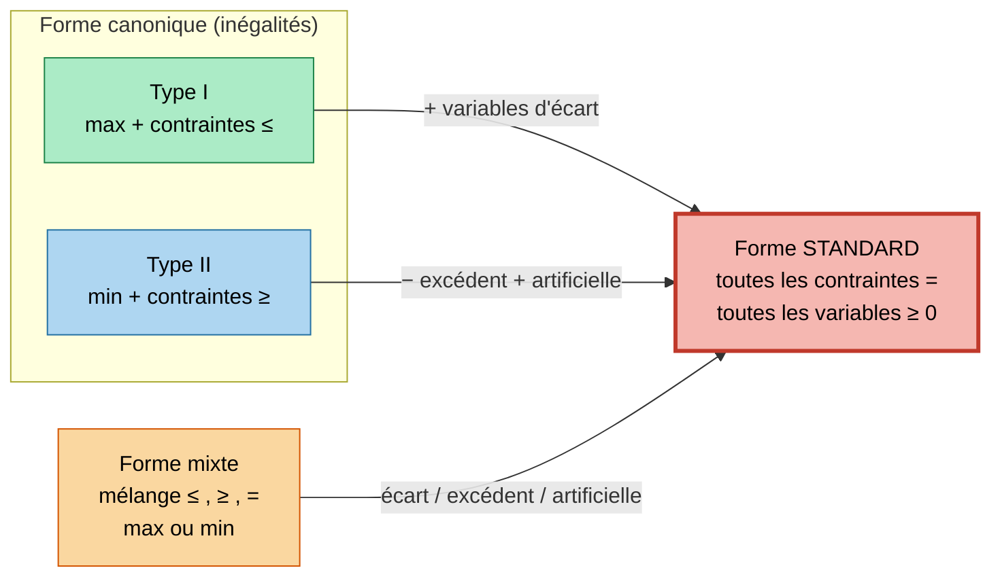

# 04 — Formes canonique, mixte et standard

⬅️ [[03 - Résolution graphique]] · ➡️ [[05 - Méthode du Simplexe]] · 🏠 [[00 - Accueil]]

---

## 1. Les trois formes

> [!definition] Forme canonique
> L'ensemble des contraintes se présente sous forme d'**inégalités** (≤ ou ≥).
> - **Type I** : contraintes **≤** et objectif **maximisation**.
> - **Type II** : contraintes **≥** et objectif **minimisation**.

> [!definition] Forme mixte
> Contraintes dans des sens différents (certaines ≤, d'autres ≥) et/ou des **égalités**, objectif max ou min.

> [!definition] Forme standard
> - **Toutes les contraintes sont des égalités** ;
> - **toutes les variables sont positives** (≥ 0) ;
> - l'objectif peut être max ou min.

**Exemple du cours :**

| Type I | Type II |
|---|---|
| $\max z = 2x_1 + 9x_2 + x_3$ | $\min z = 2x_1 + 9x_2 + x_3$ |
| $2x_1 + 2x_2 + 7x_3 \le 10$ | $2x_1 + 2x_2 + 7x_3 \ge 10$ |
| $x_1 + 3x_3 \le 7$ | $x_1 + 3x_3 \ge 7$ |
| $x_1 + 17x_2 + 15x_3 \le 25$ | $x_1 + 17x_2 + 15x_3 \ge 25$ |
| $x_1, x_2, x_3 \ge 0$ | $x_1, x_2, x_3 \ge 0$ |

> [!examen] Règle du cours
> Dans la méthode du simplexe, **tout programme sous forme canonique doit être ramené à la forme standard**, en introduisant des **variables supplémentaires positives** (variables d'**écart** ou **artificielles**), **une pour chaque contrainte**, pour réécrire les inégalités sous forme d'égalités.

## 2. Les variables à ajouter — LE tableau à connaître par cœur

| Contrainte | On ajoute | Écriture standard | Variable de base de départ |
|---|---|---|---|
| $\le b$ | **+ eᵢ** (variable d'**écart**) | $\dots + e_i = b$ | eᵢ |
| $\ge b$ | **− eᵢ** (variable d'**excédent**) **+ aᵢ** (variable **artificielle**) | $\dots - e_i + a_i = b$ | aᵢ |
| $= b$ | **+ aᵢ** (variable **artificielle**) | $\dots + a_i = b$ | aᵢ |

> [!definition] Variable d'écart (≤)
> Représente la **quantité disponible non utilisée** : l'**écart entre la disponibilité et le besoin**.
> Ex. : $x_1 + 2x_2 \le 8$ devient $x_1 + 2x_2 + e_1 = 8$ ; si $x_1 = 2, x_2 = 1$ alors $e_1 = 4$ h machine non utilisées.

> [!definition] Variable d'excédent (≥)
> Représente le **surplus** au-dessus du minimum exigé. Elle est **soustraite** : $2x_1 + 6x_2 + 2x_3 - e_1 = 6$.

> [!piege] Pourquoi une artificielle pour ≥ ?
> Si on met $x = 0$ dans $x_1 + x_2 - e_3 = 10$, on obtient $-e_3 = 10 \Rightarrow e_3 = -10 < 0$ ❌ **interdit** (variables ≥ 0).
> Donc $e_3$ ne peut pas être variable de base au départ. On ajoute $a_3 \ge 0$ : $x_1 + x_2 - e_3 + a_3 = 10$ → au départ $a_3 = 10$ ✅.
> Une artificielle **n'a aucun sens réel**, c'est un **artifice** pour obtenir une base de départ → il faudra l'éliminer : c'est la [[06 - Méthode des deux phases]].

## 3. Exemples de passage à la forme standard

### Exemple 1 — Type I (cours)

$$
\begin{cases}
\max Z = 50x_1 + 60x_2\\
x_1 + 2x_2 \le 8\\
2x_1 + 2x_2 \le 10\\
9x_1 + 4x_2 \le 36\\
x_1, x_2 \ge 0
\end{cases}
\quad\Longrightarrow\quad
\begin{cases}
\max Z = 50x_1 + 60x_2\\
x_1 + 2x_2 + x_3 = 8\\
2x_1 + 2x_2 + x_4 = 10\\
9x_1 + 4x_2 + x_5 = 36\\
x_1, \dots, x_5 \ge 0
\end{cases}
$$

(le cours appelle parfois les écarts $x_3, x_4, x_5$ au lieu de $e_1, e_2, e_3$ : c'est pareil).

### Exemple 2 — Le TP (min avec ≥) ⭐

$$
\begin{cases}
\min Z = 12x_1 + 42x_2 + 20x_3\\
2x_1 + 6x_2 + 2x_3 \ge 6\\
x_1 + 3x_2 + 2x_3 \ge 4\\
x_1, x_2, x_3 \ge 0
\end{cases}
\quad\Longrightarrow\quad
\begin{cases}
2x_1 + 6x_2 + 2x_3 - e_1 + a_1 = 6\\
x_1 + 3x_2 + 2x_3 - e_2 + a_2 = 4\\
x_j, e_i, a_i \ge 0
\end{cases}
$$

### Exemple 3 — Forme mixte (cours, deux phases)

$$
\begin{cases}
\max Z = 20x_1 + 25x_2 + 4x_3\\
2x_1 + 3x_2 + 5x_3 \le 40\\
4x_1 + 2x_2 + 3x_3 \ge 20\\
4x_1 + 2x_2 + x_3 = 10
\end{cases}
\Longrightarrow
\begin{cases}
2x_1 + 3x_2 + 5x_3 + e_1 = 40\\
4x_1 + 2x_2 + 3x_3 - e_2 + a_1 = 20\\
4x_1 + 2x_2 + x_3 + a_2 = 10
\end{cases}
$$

Base de départ : $\{e_1, a_1, a_2\}$.

## 4. Vocabulaire du simplexe

> [!definition] Variables de base / hors base
> - **Variables de base** : celles qui apparaissent dans la colonne de gauche du tableau (une par contrainte). Leur valeur = la colonne **b**.
> - **Variables hors base** : toutes les autres, elles valent **0**.
> - **Solution de base** : la solution lue dans le tableau (hors base = 0). Elle est **réalisable** si toutes les valeurs de base sont **≥ 0**. Chaque solution de base réalisable = **un sommet** de la région admissible.

> [!astuce] Nombre de variables de base
> Il y a **toujours autant de variables de base que de contraintes** ($m$).

## 5. Cas particuliers de mise en forme

> [!piege] Second membre négatif
> Si $b_i < 0$, **multiplier la contrainte par −1** et **inverser le sens** de l'inégalité **avant** d'ajouter les variables.
> Ex. : $-x_1 + 2x_2 \ge -2 \iff x_1 - 2x_2 \le 2$.

> [!astuce] min ↔ max
> $\min Z = -\max(-Z)$. On peut donc transformer un min en max en changeant le signe des coefficients. **Mais dans le TP, on traite le min directement** (voir [[05 - Méthode du Simplexe#3. Critères selon max ou min]]).

➡️ Suite : [[05 - Méthode du Simplexe]]
