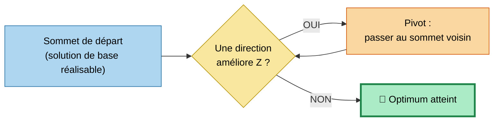
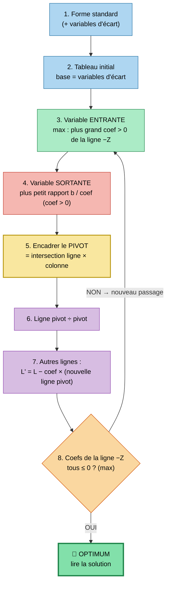

# 05 — La méthode du Simplexe (méthode des tableaux)

⬅️ [[04 - Formes canonique et standard]] · ➡️ [[06 - Méthode des deux phases]] · 🏠 [[00 - Accueil]]

---

## 1. Idée générale

> [!definition] Principe
> Quand il y a trop de variables pour le graphique, on utilise le **simplexe** : une **procédure itérative**.
> Partant d'une **solution de base réalisable** (un **sommet** du domaine), on cherche parmi les **sommets voisins** celui qui **améliore le plus** la fonction objectif, on y passe, et on recommence **jusqu'à ce qu'aucun sommet voisin n'améliore Z** → c'est l'**optimum**.

Chaque **itération** = passage d'un sommet à un **sommet adjacent**.

## 2. L'algorithme en 8 étapes (cours)

> [!formule] Les formules du pivotage
> **Ligne pivot** : $\text{nouvelle ligne pivot} = \dfrac{\text{ancienne ligne pivot}}{\text{pivot}}$
>
> **Autres lignes** (formule du cours) : $E'_{ij} = E_{ij} - \left[\dfrac{A_{ij}}{\text{Pivot}} \times \text{ligne du pivot}\right]$
> où $A_{ij}$ = valeur de la ligne à l'intersection avec la **colonne de la variable entrante**.
>
> ⇔ (plus simple) : $\text{nouvelle ligne} = \text{ancienne ligne} - A_{ij} \times \text{(nouvelle ligne pivot)}$
>
> **Règle du rectangle** (pour un seul élément) : $\text{nouveau} = \text{ancien} - \dfrac{(\text{élément sur la même ligne, colonne pivot}) \times (\text{élément sur la ligne pivot, même colonne})}{\text{pivot}}$

> [!piege] La ligne −Z se transforme exactement comme les autres lignes !
> Y compris sa case **b** : elle contient toujours **−Z** (valeur actuelle de Z avec le signe moins).

## 3. Critères selon max ou min

Le tableau du cours/TP a une ligne **« −Z »** (le cours l'appelle aussi « MAX ») qui contient au départ les **coefficients $c_j$ de la fonction objectif**, et 0 dans la case b.

| | **Maximisation** | **Minimisation** (comme le TP) |
|---|---|---|
| **Variable entrante** | plus grand coef **strictement positif** de la ligne −Z | coef **le plus négatif** de la ligne −Z |
| **Variable sortante** | plus petit rapport $\dfrac{b_i}{a_{ik}}$ avec $a_{ik} > 0$ | **pareil** |
| **Optimum atteint quand** | tous les coefs de −Z sont **≤ 0** | tous les coefs de −Z sont **≥ 0** |
| **Valeur de Z** | $Z = -(\text{case b de la ligne }-Z)$ | **pareil** |

> [!astuce] Comment s'en souvenir ?
> La ligne −Z contient les « gains marginaux » $c_j - z_j$ : de combien Z change si on fait entrer 1 unité de la variable.
> - **max** : on veut un gain **positif** → on prend le plus grand positif ; plus aucun positif ⇒ plus rien à gagner.
> - **min** : on veut faire **baisser** Z → on prend le plus négatif ; plus aucun négatif ⇒ on ne peut plus baisser.

> [!piege] Test du rapport (variable sortante)
> - On ne calcule le rapport **que si le coefficient de la colonne pivot est strictement positif** (> 0).
> - Coefficient **0 ou négatif** → la ligne **ne participe pas** (rapport = ∞). Le TP le dit : « *la deuxième ligne ne participe pas au test des rapports, car son coefficient dans la colonne de x₁ est nul* ».
> - Si **aucun** coefficient n'est > 0 → problème **non borné** ([[08 - Cas particuliers]]).
> - En cas d'**égalité** de rapports : choisir l'une des deux (par ex. la première) ; on aura une variable de base = 0 (dégénérescence), ce n'est pas grave.

## 4. Exemple complet du cours (atelier X / Y)

> [!exercice] Énoncé
> Un atelier fabrique X et Y. Ventes plafonnées à **400** X et **600** Y. X demande **3 h** de main-d'œuvre, Y **2 h** ; **1800 h** disponibles. Marge : **30 DH** par X, **50 DH** par Y. Maximiser la marge.

**Modèle :**

$$
(P)\begin{cases}
\max Z = 30x + 50y\\
3x + 2y \le 1800 & \text{(contrainte technique)}\\
x \le 400 & \text{(marché X)}\\
y \le 600 & \text{(marché Y)}\\
x \ge 0,\ y \ge 0
\end{cases}
\quad\xrightarrow{\text{standard}}\quad
\begin{cases}
3x + 2y + e_1 = 1800\\
x + e_2 = 400\\
y + e_3 = 600
\end{cases}
$$

### Tableau initial
Base = $\{e_1, e_2, e_3\}$ (les variables d'écart) ; hors base = $x, y$ (= 0).

| Base | x | y | e1 | e2 | e3 | b | Rapport |
|---|---|---|---|---|---|---|---|
| e1 | 3 | 2 | 1 | 0 | 0 | 1800 | 1800/2 = 900 |
| e2 | 1 | 0 | 0 | 1 | 0 | 400 | 400/0 → ∞ |
| e3 | 0 | 1 | 0 | 0 | 1 | 600 | 600/1 = **600** ✅ |
| **−Z (MAX)** | 30 | **50** | 0 | 0 | 0 | 0 | |

- **Entrante** : plus grand coef > 0 de la ligne MAX = **50** → y
- **Sortante** : plus petit rapport = 600 → e3
- **Pivot** = 1

### Itération 1 — calculs détaillés

1. **Ligne pivot** ÷ 1 : $y = [0,\ 1,\ 0,\ 0,\ 1 \mid 600]$
2. **Ligne e1** ($A = 2$) : $[3, 2, 1, 0, 0 \mid 1800] - 2\times[0, 1, 0, 0, 1 \mid 600] = [3, 0, 1, 0, -2 \mid 600]$
3. **Ligne e2** ($A = 0$) : inchangée $[1, 0, 0, 1, 0 \mid 400]$
4. **Ligne −Z** ($A = 50$) : $[30, 50, 0, 0, 0 \mid 0] - 50\times[0, 1, 0, 0, 1 \mid 600] = [30, 0, 0, 0, -50 \mid -30000]$

| Base | x | y | e1 | e2 | e3 | b | Rapport |
|---|---|---|---|---|---|---|---|
| e1 | 3 | 0 | 1 | 0 | −2 | 600 | 600/3 = **200** ✅ |
| e2 | 1 | 0 | 0 | 1 | 0 | 400 | 400/1 = 400 |
| y | 0 | 1 | 0 | 0 | 1 | 600 | 600/0 → ∞ |
| **−Z** | **30** | 0 | 0 | 0 | −50 | −30 000 | |

Il reste un coefficient positif (30) → **nouveau passage**. Entrante x, sortante e1, pivot 3.

### Itération 2 — calculs détaillés

1. **Ligne pivot** ÷ 3 : $x = [1,\ 0,\ \tfrac13,\ 0,\ -\tfrac23 \mid 200]$
2. **Ligne e2** ($A = 1$) : $[1, 0, 0, 1, 0 \mid 400] - 1\times[1, 0, \tfrac13, 0, -\tfrac23 \mid 200] = [0, 0, -\tfrac13, 1, \tfrac23 \mid 200]$
3. **Ligne y** ($A = 0$) : inchangée
4. **Ligne −Z** ($A = 30$) : $[30, 0, 0, 0, -50 \mid -30000] - 30\times[1, 0, \tfrac13, 0, -\tfrac23 \mid 200] = [0, 0, -10, 0, -30 \mid -36000]$

### Tableau final

| Base | x | y | e1 | e2 | e3 | b |
|---|---|---|---|---|---|---|
| x | 1 | 0 | 1/3 | 0 | −2/3 | **200** |
| e2 | 0 | 0 | −1/3 | 1 | 2/3 | **200** |
| y | 0 | 1 | 0 | 0 | 1 | **600** |
| **−Z** | 0 | 0 | −10 | 0 | −30 | **−36 000** |

Tous les coefficients de la ligne −Z sont **≤ 0** → OPTIMUM.

> [!solution] Lecture de la solution
> - Variables de base : $x = 200$, $y = 600$, $e_2 = 200$
> - Hors base : $e_1 = 0$, $e_3 = 0$
> - $Z_{\max} = -(-36\,000) = 36\,000$ DH
>
> **Vérification** : $3(200) + 2(600) = 1800 \le 1800$ ✓ ; $200 \le 400$ ✓ ; $600 \le 600$ ✓ ; $Z = 30(200) + 50(600) = 6000 + 30000 = 36000$ ✓

## 5. Contraintes saturées et marginales

> [!definition] Définitions
> - **Contrainte saturée** : son écart est **nul** (la ressource est entièrement utilisée).
> - **Contrainte marginale** (non saturée) : son écart est **non nul** (il reste de la ressource).
> - Pour une contrainte **≥**, on parle de **surplus** et non d'écart.

Dans l'exemple :
- $e_1 = 0$ → contrainte technique (main-d'œuvre) **saturée** ;
- $e_3 = 0$ → marché de Y **saturé** ;
- $e_2 = 200$ → marché de X **non saturé** : on aurait pu vendre **200 X de plus**.

> [!astuce] Bonus : interprétation des coefficients finaux de −Z
> Sous $e_1$ on lit **−10** : 1 heure de main-d'œuvre en plus ferait gagner **10 DH**. Sous $e_3$ : **−30** → 1 Y de plus vendable ferait gagner 30 DH. Ce sont les **prix marginaux** = les valeurs des variables **duales** (voir [[07 - Dualité]]).

## 6. Remarques importantes

> [!piege] À vérifier à chaque tableau
> - Les valeurs des variables de base (colonne **b**) doivent être **≥ 0**. Si tu obtiens un b négatif → tu as fait une erreur (mauvais choix de sortante ou erreur de calcul).
> - Dans la colonne d'une variable de base : **un 1 sur sa ligne et des 0 partout ailleurs** (y compris ligne −Z). C'est un très bon contrôle.
> - La valeur de **−Z** doit évoluer dans le bon sens : Z augmente (max) / diminue (min) à chaque itération (ou reste égale en cas de dégénérescence).

## 7. Résumé de l'algorithme (cours)

1. Mettre le problème sous **forme standard**.
2. Construire le **tableau initial**.
3. Identifier la **variable entrante**.
4. Identifier la **variable sortante** par le **test du rapport**.
5. Déterminer le **pivot**.
6. Effectuer le **pivotage**.
7. Construire le **nouveau tableau**.
8. Vérifier le **critère d'optimalité**.
9. Si le critère n'est pas satisfait, **recommencer**.

> [!exercice] Exercice du cours (à faire seul !)
> Usine : pièces P1 et P2 dans ateliers A1 et A2.
> P1 : 3 h en A1, 6 h en A2. P2 : 4 h en A1, 3 h en A2. Disponibilités : A1 = 160 h, A2 = 180 h. Marges : 1200 (P1), 1000 (P2).
> Résoudre par le **simplexe** puis **graphiquement**.
> → Correction : [[11 - Exercices du cours corrigés#Exercice 3 — Pièces P1 et P2 (simplexe + graphique)]]

➡️ Suite : [[06 - Méthode des deux phases]]
