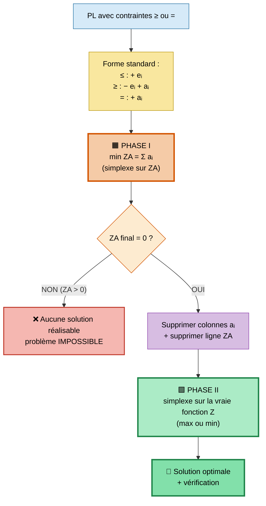

# 06 — La méthode des deux phases ⭐⭐⭐⭐⭐

⬅️ [[05 - Méthode du Simplexe]] · ➡️ [[07 - Dualité]] · 🏠 [[00 - Accueil]]
📝 Application directe : [[10 - TP corrigé - Deux phases (modèle d'examen)]]

---

## 1. Pourquoi deux phases ?

> [!definition] Le problème
> Le simplexe « simple » suppose que **toutes les contraintes sont ≤** avec des seconds membres **≥ 0** : la base de départ est alors évidente (les variables d'écart).
> Dès qu'il y a des contraintes **≥** ou **=**, on **n'a pas de base de départ réalisable évidente** → on utilise la **méthode des deux phases** (la plus courante).

**Exemple du cours** :

$$
(PL_C)\begin{cases}
\max Z = 5x_1 + 2x_2\\
2x_1 + x_2 \le 70\\
x_1 \le 30\\
x_1 + x_2 \ge 10\\
x_1, x_2 \ge 0
\end{cases}
\xrightarrow{\text{écarts}}
(PL_S)\begin{cases}
2x_1 + x_2 + e_1 = 70\\
x_1 + e_2 = 30\\
x_1 + x_2 - e_3 = 10
\end{cases}
$$

> [!piege] Le blocage
> Dans la 3ᵉ contrainte, prendre $e_3$ comme variable de base donnerait $e_3 = -10 < 0$ ❌ (contradiction).
> **L'astuce** : ajouter une **variable artificielle** $a_1 \ge 0$ dans chaque contrainte non réalisable quand on remplace les variables originales par 0 :
> $$x_1 + x_2 - e_3 + a_1 = 10 \quad\Rightarrow\quad a_1 = 10 \text{ au départ ✅}$$

> [!theoreme] Proposition (cours)
> $$(PL_S) \iff (PL_A) \iff a_1 = 0$$
> Pour que la contrainte d'origine soit respectée, il faut que **l'artificielle soit nulle**. L'algorithme doit la **faire sortir de la base**. Si c'est impossible → **le problème n'a pas de solution**.
> ⚠️ La variable artificielle **n'appartient pas au problème réel** : c'est un artifice pour construire une base réalisable.

## 2. Vue d'ensemble

## 3. Phase I — trouver une solution réalisable

> [!definition] Problème auxiliaire
> On **minimise la somme des variables artificielles** :
> $$\min Z_A = a_1 + a_2 + \dots + a_k$$
> Comme les $a_i \ge 0$, le minimum vaut **0** exactement quand **toutes** les artificielles sont nulles. Si le minimum est > 0, il n'y a **pas de solution**.

### Étape clé : exprimer ZA en fonction des variables HORS base

> [!piege] Règle du cours
> « Il ne faut pas que la fonction objectif soit en fonction des variables de base. » Or $a_1, a_2$ sont **de base** au départ → on les remplace à l'aide des contraintes.

**Exemple TP** :
$$a_1 = 6 - 2x_1 - 6x_2 - 2x_3 + e_1 \qquad a_2 = 4 - x_1 - 3x_2 - 2x_3 + e_2$$
$$Z_A = a_1 + a_2 = 10 - 3x_1 - 9x_2 - 4x_3 + e_1 + e_2$$

> [!formule] Raccourci pour remplir la ligne ZA du tableau
> **Ligne ZA = somme des lignes des contraintes qui contiennent une variable artificielle**, en mettant **0 sous les colonnes des artificielles**.
> La case **b** de ZA = somme des b de ces lignes = **valeur initiale de ZA**.
>
> TP : ligne(a1) + ligne(a2) = $[2+1,\ 6+3,\ 2+2,\ -1+0,\ 0-1 \mid 6+4] = [3,\ 9,\ 4,\ -1,\ -1 \mid 10]$ ✅

### Les deux conventions (même chose, signe opposé)

> [!examen] Convention du TP (corrigé officiel) — ligne « ZA »
> - Ligne ZA = **somme des lignes artificielles** (coefficients positifs pour les variables qui font baisser ZA).
> - **Entrante** : coefficient **positif le plus élevé** de la ligne ZA.
> - **Fin de la phase I** : plus aucun coefficient positif dans ZA (hors colonnes artificielles), et la case b de ZA vaut **0**.

> [!info] Convention du cours (diapos) — ligne « −Za »
> - Ligne −Za = **l'opposé** : on écrit $-1, -1, 0, 0, 1, 0 \mid -10$.
> - **Entrante** : coefficient **le plus négatif** de la ligne −Za.
> - **Fin** : plus aucun coefficient strictement négatif.
>
> 👉 Les deux sont **équivalentes**. Choisis-en **une** et garde-la jusqu'au bout. Je recommande celle du **TP** (c'est le dernier corrigé donné par le prof).

### Pendant la phase I
- On garde la ligne **−Z** (objectif réel) dans le tableau et on la **met à jour à chaque pivot** comme une ligne normale : ainsi elle est **prête pour la phase II**.
- Le test du rapport est le même qu'au simplexe (b / coef, coef > 0 seulement).
- Le cours précise : on **peut supprimer la colonne d'une variable artificielle dès qu'elle sort de la base** (elle ne reviendra jamais). Le TP, lui, garde les colonnes jusqu'à la fin de la phase I : les deux sont acceptés.

## 4. Fin de la phase I : le test décisif

| Résultat | Conclusion |
|---|---|
| $Z_A = 0$ (toutes les $a_i$ hors base ou nulles) | ✅ on a une **solution de base réalisable** → **phase II** |
| $Z_A > 0$ (une $a_i$ reste en base avec une valeur > 0) | ❌ le problème **n'admet aucune solution réalisable** |

> [!piege] Cas rare : artificielle en base avec la valeur 0
> Si à la fin de la phase I une $a_i$ est encore en base mais avec $b = 0$, $Z_A = 0$ : la solution est réalisable. On fait sortir $a_i$ par un pivot sur n'importe quel coefficient **non nul** de sa ligne (colonne non artificielle) ; si toute sa ligne est nulle, la contrainte était **redondante** → on supprime la ligne.

## 5. Phase II — optimiser le vrai objectif

1. **Supprimer** les colonnes des variables artificielles **et** la ligne ZA.
2. **Garder** la ligne −Z telle qu'elle a été mise à jour pendant la phase I (elle est déjà exprimée en fonction des variables hors base).
3. Appliquer le **simplexe normal** :
   - **max** : entrante = plus grand coef **> 0** de −Z, arrêt quand tous **≤ 0** ;
   - **min** : entrante = coef **le plus négatif** de −Z, arrêt quand tous **≥ 0**.
4. Lire la solution, $Z = -(\text{case b de }-Z)$, **vérifier**.

## 6. Exemple complet du cours (max Z = 5x₁ + 2x₂)

**Problème auxiliaire** :
$$
(PL_A)\begin{cases}
\min Z_A = a_1 = 10 - x_1 - x_2 + e_3\\
2x_1 + x_2 + e_1 = 70\\
x_1 + e_2 = 30\\
x_1 + x_2 - e_3 + a_1 = 10
\end{cases}
$$
Solution de base initiale : $(x_1, x_2) = (0, 0)$ ; $(e_1, e_2, e_3) = (70, 30, 0)$ ; $a_1 = 10$. Base = $\{e_1, e_2, a_1\}$.

### Tableau initial de la phase I

| Base | x1 | x2 | e1 | e2 | e3 | a1 | b | Rapport |
|---|---|---|---|---|---|---|---|---|
| e1 | 2 | 1 | 1 | 0 | 0 | 0 | 70 | 70/2 = 35 |
| e2 | 1 | 0 | 0 | 1 | 0 | 0 | 30 | 30/1 = 30 |
| a1 | 1 | 1 | 0 | 0 | −1 | 1 | 10 | 10/1 = **10** ✅ |
| −Z | 5 | 2 | 0 | 0 | 0 | 0 | 0 | |
| **ZA** (TP) | **1** | 1 | 0 | 0 | −1 | 0 | 10 | |
| *−Za (cours)* | *−1* | *−1* | *0* | *0* | *1* | *0* | *−10* | |

- Entrante : $x_1$ (coef 1 dans ZA ; égalité avec $x_2$, on prend $x_1$ comme le cours).
- Sortante : $a_1$ (plus petit rapport 10). Pivot = 1.

**Calculs** (ligne pivot $= [1, 1, 0, 0, -1, 1 \mid 10]$) :
- e1 : $[2,1,1,0,0,0 \mid 70] - 2\times\text{pivot} = [0,-1,1,0,2,-2 \mid 50]$
- e2 : $[1,0,0,1,0,0 \mid 30] - 1\times\text{pivot} = [0,-1,0,1,1,-1 \mid 20]$
- −Z : $[5,2,0,0,0,0 \mid 0] - 5\times\text{pivot} = [0,-3,0,0,5,-5 \mid -50]$
- ZA : $[1,1,0,0,-1,0 \mid 10] - 1\times\text{pivot} = [0,0,0,0,0,-1 \mid 0]$

| Base | x1 | x2 | e1 | e2 | e3 | a1 | b |
|---|---|---|---|---|---|---|---|
| e1 | 0 | −1 | 1 | 0 | 2 | −2 | 50 |
| e2 | 0 | −1 | 0 | 1 | 1 | −1 | 20 |
| x1 | 1 | 1 | 0 | 0 | −1 | 1 | 10 |
| −Z | 0 | −3 | 0 | 0 | 5 | −5 | −50 |
| **ZA** | 0 | 0 | 0 | 0 | 0 | −1 | **0** |

> [!solution] Fin de la phase I
> Plus de coefficient positif dans ZA et $Z_A = 0$ ✅. Solution réalisable : $(x_1, x_2) = (10, 0)$, $(e_1, e_2, e_3) = (50, 20, 0)$.

### Phase II

On supprime la colonne $a_1$ et la ligne ZA :

| Base | x1 | x2 | e1 | e2 | e3 | b | Rapport |
|---|---|---|---|---|---|---|---|
| e1 | 0 | −1 | 1 | 0 | 2 | 50 | 50/2 = 25 |
| e2 | 0 | −1 | 0 | 1 | 1 | 20 | 20/1 = **20** ✅ |
| x1 | 1 | 1 | 0 | 0 | −1 | 10 | coef −1 → ✗ |
| −Z | 0 | −3 | 0 | 0 | **5** | −50 | |

**max** → entrante = plus grand positif = $e_3$ (5). Sortante $e_2$. Pivot 1.

| Base | x1 | x2 | e1 | e2 | e3 | b | Rapport |
|---|---|---|---|---|---|---|---|
| e1 | 0 | 1 | 1 | −2 | 0 | 10 | 10/1 = **10** ✅ |
| e3 | 0 | −1 | 0 | 1 | 1 | 20 | ✗ |
| x1 | 1 | 0 | 0 | 1 | 0 | 30 | ✗ (0) |
| −Z | 0 | **2** | 0 | −5 | 0 | −150 | |

Encore un positif (2) → entrante $x_2$, sortante $e_1$, pivot 1.

| Base | x1 | x2 | e1 | e2 | e3 | b |
|---|---|---|---|---|---|---|
| x2 | 0 | 1 | 1 | −2 | 0 | **10** |
| e3 | 0 | 0 | 1 | −1 | 1 | **30** |
| x1 | 1 | 0 | 0 | 1 | 0 | **30** |
| −Z | 0 | 0 | −2 | −1 | 0 | **−170** |

> [!solution] Solution optimale
> Tous les coefficients de −Z sont ≤ 0 → optimum.
> $x_1^* = 30$, $x_2^* = 10$, $Z_{\max} = 170$ (et $e_3 = 30$ : la 3ᵉ contrainte a un surplus de 30).
> Vérif : $2(30)+10 = 70 \le 70$ ✓ ; $30 \le 30$ ✓ ; $30+10 = 40 \ge 10$ ✓ ; $Z = 150 + 20 = 170$ ✓

## 7. Conclusion du cours

> [!examen] À savoir réciter
> - Les variables artificielles sont un **artifice mathématique temporaire** introduit lors de la mise sous forme standard pour **forcer l'apparition d'une base canonique de départ**. La phase I a pour **seul but de s'en débarrasser**.
> - La phase I minimise la **somme des artificielles** $Z_A$.
> - **Si $Z_A \ne 0$** → aucune solution réalisable, donc aucune solution du PL.
> - **Si $Z_A = 0$** → on a une solution réalisable ; on **supprime les colonnes des artificielles** et on passe à la phase II sur le problème d'origine.

> [!exercice] Exercice du cours (déchets) — à faire !
> Plastique (40 €/t) et Métal (30 €/t). Temps : 2 h/t (P), 1 h/t (M), **≤ 16 h**. Traiter **au moins 4 t** au total. Budget : 10 €/t (P), 20 €/t (M), **exactement 80 €**. Maximiser le gain.
> → Correction : [[11 - Exercices du cours corrigés#Exercice 4 — Déchets Plastique et Métal (deux phases, max)]]

➡️ Maintenant : [[10 - TP corrigé - Deux phases (modèle d'examen)]]
