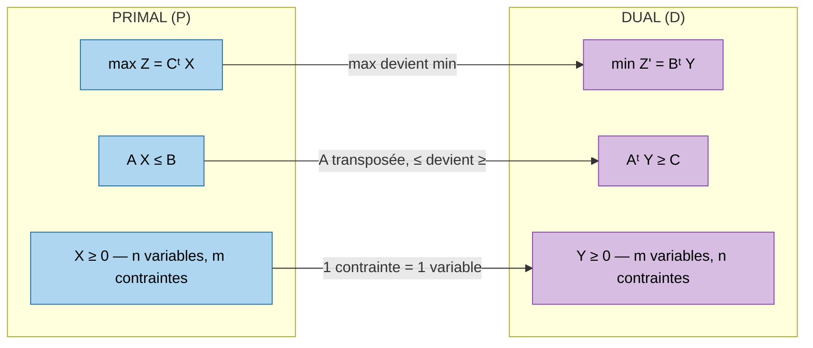
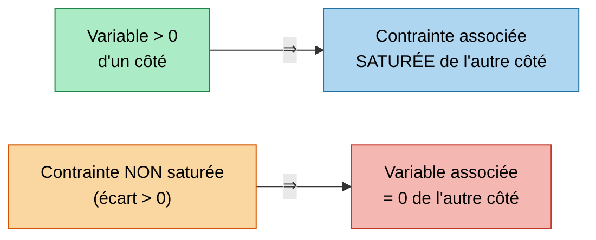

# 07 — Dualité en programmation linéaire

⬅️ [[06 - Méthode des deux phases]] · ➡️ [[08 - Cas particuliers]] · 🏠 [[00 - Accueil]]

---

## 1. Introduction

> [!definition] Idée
> À chaque PL (le **primal** P) on associe un autre PL : le **dual** (D).
> - Parfois il est **plus avantageux de résoudre le dual**, puis d'en **déduire** la solution du primal.
> - Très utile quand le primal a **beaucoup de variables** (le dual aura alors peu de contraintes… et inversement), ou quand le primal est un **min avec des ≥** (deux phases nécessaires) alors que son dual est un **max avec des ≤** (simplexe simple ou graphique !).

## 2. Définition

$$
(P)\begin{cases}\max Z = C^tX\\ A\,X \le B\\ X \ge 0\end{cases}
\qquad\Longleftrightarrow\qquad
(D)\begin{cases}\min Z' = B^tY\\ A^t\,Y \ge C\\ Y \ge 0\end{cases}
$$

où $A^t$ est la **transposée** de $A$.

> [!methode] Construction du dual (cours)
> 1. Les **seconds membres** (B) deviennent les **coefficients de l'objectif**, et réciproquement.
> 2. **max** devient **min** (et inversement).
> 3. Les inégalités **≤** deviennent **≥** (forme canonique).
> 4. La matrice $A$ est **transposée** (les lignes deviennent des colonnes).
> 5. **1 contrainte du primal ↔ 1 variable du dual**, et **1 variable du primal ↔ 1 contrainte du dual**.

### Tableau de correspondance complet (cas général)

| **Problème de MAXIMISATION** | ↔ | **Problème de MINIMISATION** |
|---|---|---|
| Nombre de contraintes | ↔ | Nombre de variables |
| Nombre de variables | ↔ | Nombre de contraintes |
| ***Type des contraintes*** | | ***Type des variables*** |
| contrainte **=** | ↔ | variable **quelconque** (∈ ℝ) |
| contrainte **≤** | ↔ | variable **≥ 0** |
| contrainte **≥** | ↔ | variable **≤ 0** |
| ***Type des variables*** | | ***Type des contraintes*** |
| variable **quelconque** | ↔ | contrainte **=** |
| variable **≥ 0** | ↔ | contrainte **≥** |
| variable **≤ 0** | ↔ | contrainte **≤** |

> [!astuce] Comment le retenir
> Côté **max** les contraintes « normales » sont **≤** ; côté **min** elles sont **≥**. Les variables « normales » sont **≥ 0**.
> Normal ↔ normal ; « bizarre » (sens inverse) ↔ variable ≤ 0 ; **égalité ↔ variable libre**.

## 3. Exemples de construction

### Exemple 1 (cours)
$$
(P)\begin{cases}\max Z = 10x_1 + 20x_2 + 30x_3\\ x_1 + x_2 + 4x_3 \le 150\\ 4x_1 + 2x_2 + 3x_3 \le 440\\ x_1,x_2,x_3\ge 0\end{cases}
\quad
A=\begin{pmatrix}1&1&4\\4&2&3\end{pmatrix},\ C^t = (10\ 20\ 30),\ B=\begin{pmatrix}150\\440\end{pmatrix}
$$

$$
A^t=\begin{pmatrix}1&4\\1&2\\4&3\end{pmatrix}
\quad\Longrightarrow\quad
(D)\begin{cases}\min Z' = 150y_1 + 440y_2\\ y_1 + 4y_2 \ge 10\\ y_1 + 2y_2 \ge 20\\ 4y_1 + 3y_2 \ge 30\\ y_1, y_2 \ge 0\end{cases}
$$

### Exemple 2 (cours)
$$
(P)\begin{cases}\max Z = 100x_1 + 200x_2\\ x_1 + x_2 \le 150\\ 4x_1 + 2x_2 \le 440\\ x_1 + 4x_2 \le 480\\ x_1 \le 90\\ x_1,x_2\ge0\end{cases}
\quad\Longrightarrow\quad
(D)\begin{cases}\min Z' = 150y_1 + 440y_2 + 480y_3 + 90y_4\\ y_1 + 4y_2 + y_3 + y_4 \ge 100\\ y_1 + 2y_2 + 4y_3 \ge 200\\ y_1,y_2,y_3,y_4 \ge 0\end{cases}
$$

> [!piege] Attention à la contrainte $x_1 \le 90$
> Elle s'écrit $1\cdot x_1 + 0\cdot x_2 \le 90$ → la 4ᵉ colonne de $A^t$ est $(1, 0)$ : $y_4$ apparaît dans la 1ʳᵉ contrainte duale mais **pas** dans la 2ᵉ.

### Exemples avec cas particuliers

> [!exercice] Entraîne-toi : cache la colonne Dual et retrouve-la
>
> | Primal | Dual |
> |---|---|
> | $\max \frac12 x_1 + x_2$ ; $x_1 + x_2 \le 3$ ; $-x_1 + x_2 \le 1$ ; $x_1 \le 2$ ; $x_1,x_2 \ge 0$ | $\min 3y_1 + y_2 + 2y_3$ ; $y_1 - y_2 + y_3 \ge \frac12$ ; $y_1 + y_2 \ge 1$ ; $y_1,y_2,y_3 \ge 0$ |
> | $\min -x_1 + x_2$ ; $2x_1 - x_2 \ge 2$ ; $-x_1 + 2x_2 \ge -2$ ; $x_1 + x_2 \le 5$ ; $x_1,x_2\ge0$ | $\max 2y_1 - 2y_2 + 5y_3$ ; $2y_1 - y_2 + y_3 \le -1$ ; $-y_1 + 2y_2 + y_3 \le 1$ ; $y_1 \ge 0,\ y_2 \ge 0,\ $**$y_3 \le 0$** |
> | $\max 2x_1 - x_2$ ; $x_1 - x_2 = 3$ ; $x_1 \le 4$ ; $x_1,x_2\ge0$ | $\min 3y_1 + 4y_2$ ; $y_1 + y_2 \ge 2$ ; $-y_1 \ge -1$ ; **$y_1 \in \mathbb{R}$**, $y_2 \ge 0$ |
> | $\max 2x_1 - x_2$ ; $x_1 - 2x_2 \le 2$ ; $x_1 + x_2 = 6$ ; $x_2 \le 5$ ; **$x_1, x_2 \in \mathbb{R}$** | $\min 2y_1 + 6y_2 + 5y_3$ ; **$y_1 + y_2 = 2$** ; **$-2y_1 + y_2 + y_3 = -1$** ; $y_1 \ge 0$, **$y_2 \in \mathbb{R}$**, $y_3 \ge 0$ |
>
> Explications : ligne 2, la contrainte $x_1 + x_2 \le 5$ est « à l'envers » pour un **min** → $y_3 \le 0$. Ligne 3, la contrainte **=** donne $y_1$ **libre**. Ligne 4, variables primales **libres** → contraintes duales **=**.

## 4. Caractéristiques et théorèmes

> [!theoreme] Caractéristiques
> - Le dual d'un **max** est un **min** ; le dual d'un **min** est un **max**.
> - Les coefficients de l'objectif du primal sont les seconds membres des contraintes du dual, et réciproquement.
> - **Le dual du dual est le primal.**

> [!theoreme] Théorème 1 (existence)
> Si le primal admet une solution optimale, alors le dual admet aussi une solution optimale, **et réciproquement**.

> [!theoreme] Théorème 2 (dualité forte)
> Les valeurs optimales sont **égales** :
> $$Z^* = Z'^*$$
> Résoudre le primal ou le dual conduit à **la même valeur optimale**.

> [!theoreme] Théorème 3 (écarts complémentaires / complémentarité)
> Soit $X^* = (x_1^*, \dots, x_n^*)$ optimal pour le primal et $Y^* = (y_1^*, \dots, y_m^*)$ optimal pour le dual :
> - Si $x_j^* > 0$ ⇒ la **j-ième contrainte du dual est saturée**.
> - Si la j-ième contrainte du dual **n'est pas saturée** ⇒ $x_j^* = 0$.
> - Si $y_i^* > 0$ ⇒ la **i-ième contrainte du primal est saturée**.
> - Si la i-ième contrainte du primal **n'est pas saturée** ⇒ $y_i^* = 0$.
>
> **Effet miroir** : à une contrainte duale **saturée** (écart nul) correspond une variable primale **active** ; à une contrainte duale **libre** (écart > 0) correspond une variable primale **nulle**.

## 5. Méthode de résolution par dualité

> [!methode] Étapes générales (cours)
> 1. Écrire le problème **primal**.
> 2. Identifier les matrices **A, B, C**.
> 3. Construire le **dual**.
> 4. **Résoudre le dual** (graphiquement s'il a 2 variables, ou par simplexe).
> 5. Calculer la **valeur optimale** du dual.
> 6. **Théorèmes 1 et 2** → valeur optimale du primal ($Z^* = Z'^*$).
> 7. **Complémentarité** → trouver les variables du primal (variables nulles + système d'équations).
> 8. **Vérifier** que les deux valeurs optimales sont identiques.

### Application du cours

$$
(P)\begin{cases}\min Z = 200y_1 + 1566y_2 + 2880y_3\\ y_1 + 9y_2 + 12y_3 \ge 350\\ y_1 + 6y_2 + 16y_3 \ge 300\\ y_1,y_2,y_3\ge0\end{cases}
$$

**Étape 1 — Dual.** $A=\begin{pmatrix}1&9&12\\1&6&16\end{pmatrix}$, $A^t=\begin{pmatrix}1&1\\9&6\\12&16\end{pmatrix}$ :

$$
(D)\begin{cases}\max Z' = 350x_1 + 300x_2\\ x_1 + x_2 \le 200\\ 9x_1 + 6x_2 \le 1566\\ 12x_1 + 16x_2 \le 2880\\ x_1,x_2 \ge 0\end{cases}
$$

**Étape 2 — Résolution graphique du dual.**

![[graph-dual-application.svg]]

| Sommet | Comment | $Z' = 350x_1 + 300x_2$ |
|---|---|---|
| A(0 ; 180) | axe ∩ 3ᵉ contrainte | 54 000 |
| B(80 ; 120) | 1ʳᵉ ∩ 3ᵉ | 64 000 |
| **C(122 ; 78)** | 1ʳᵉ ∩ 2ᵉ : $x_1+x_2=200$, $9x_1+6x_2=1566$ ⇒ $3x_1 = 366$ | 66 100 ✅ |
| D(174 ; 0) | 2ᵉ ∩ axe | 60 900 |

**Étape 3 — Retour au primal.**
- Théorème 1 : le dual a une solution optimale ⇒ le primal aussi.
- Théorème 2 : $Z = Z' = 66\,100$.
- Théorème 3 : on remplace $x_1 = 122$, $x_2 = 78$ dans les contraintes duales :
  - $122 + 78 = 200$ → **saturée**
  - $9(122) + 6(78) = 1566$ → **saturée**
  - $12(122) + 16(78) = 2712 < 2880$ → **non saturée** ⇒ $y_3 = 0$
- De plus $x_1 > 0$ et $x_2 > 0$ ⇒ les 2 contraintes du primal sont **saturées** (égalités) :
$$\begin{cases}y_1 + 9y_2 = 350\\ y_1 + 6y_2 = 300\end{cases} \Rightarrow 3y_2 = 50 \Rightarrow y_2 = \tfrac{50}{3},\quad y_1 = 300 - 100 = 200$$

> [!solution] Solution du primal
> $y_1^* = 200$, $y_2^* = \frac{50}{3}$, $y_3^* = 0$, $Z_{\min} = 200(200) + 1566\cdot\frac{50}{3} = 40\,000 + 26\,100 = 66\,100 = Z'$ ✓

## 6. Méthode alternative : lecture directe dans le tableau final ⭐

> [!theoreme] Propriété fondamentale
> Les coefficients des **variables d'écart du dual** dans la **ligne objectif** du tableau **optimal** donnent **exactement les valeurs optimales des variables du primal** (en valeur absolue selon la convention).

Tableau optimal du dual de l'application (écarts $e_1, e_2, e_3$) :

| Base | x1 | x2 | e1 | e2 | e3 | B |
|---|---|---|---|---|---|---|
| x1 | 1 | 0 | −2 | 1/3 | 0 | 122 |
| x2 | 0 | 1 | 3 | −1/3 | 0 | 78 |
| e3 | 0 | 0 | −24 | 4/3 | 1 | 168 |
| **Z'** | 0 | 0 | 200 | 50/3 | 0 | 66 100 |

→ sous $e_1$ : $y_1 = 200$ ; sous $e_2$ : $y_2 = 50/3$ ; sous $e_3$ : $y_3 = 0$. **Instantané !**

> [!piege] Signe
> Dans la convention « −Z » du TP, la ligne contient **−200, −50/3, 0** : on prend la **valeur absolue**. Le cours affiche directement les valeurs positives.

### Généralisation (si le tableau vient de la méthode des deux phases)

| Type de contrainte (problème résolu) | Variables introduites | Où lire la variable de l'autre problème dans la ligne objectif |
|---|---|---|
| **≤** | écart $+e_i$ | sous la colonne de l'**écart** $e_i$ |
| **≥** | excédent $-e_i$ + artificielle $a_i$ | sous la colonne de l'**excédent** $e_i$ |
| **=** | artificielle $a_i$ | sous la colonne de l'**artificielle** $a_i$ |

On prend la **valeur absolue** pour garantir $y_i \ge 0$.

## 7. Le TP résolu par dualité ⭐

$$
(P)\begin{cases}\min Z = 12x_1 + 42x_2 + 20x_3\\ 2x_1 + 6x_2 + 2x_3 \ge 6 & (c_1)\\ x_1 + 3x_2 + 2x_3 \ge 4 & (c_2)\\ x_1,x_2,x_3 \ge 0\end{cases}
\quad\Longrightarrow\quad
(D)\begin{cases}\max Z' = 6y_1 + 4y_2\\ 2y_1 + y_2 \le 12 & (d_1)\\ 6y_1 + 3y_2 \le 42 & (d_2)\\ 2y_1 + 2y_2 \le 20 & (d_3)\\ y_1,y_2 \ge 0\end{cases}
$$

> [!astuce] Pourquoi c'est malin
> Le primal demande **deux phases** (contraintes ≥). Le dual n'a que des **≤** et **2 variables** → **graphique** ou **simplexe simple** !

![[graph-dual-TP.svg]]

**Sommets du dual** : $(0,0)$ → 0 ; $(6,0)$ → 36 ; $(0,10)$ → 40 ; **$(2,8)$** ($d_1 \cap d_3$ : $2y_1 + y_2 = 12$ et $y_1 + y_2 = 10$ ⇒ $y_1 = 2, y_2 = 8$) → $Z' = 12 + 32 = $ **44** ✅

**Complémentarité :**
- $y_1 = 2 > 0$ ⇒ $(c_1)$ saturée : $2x_1 + 6x_2 + 2x_3 = 6$
- $y_2 = 8 > 0$ ⇒ $(c_2)$ saturée : $x_1 + 3x_2 + 2x_3 = 4$
- $(d_2)$ : $6(2) + 3(8) = 36 < 42$ → **non saturée** ⇒ $x_2 = 0$
- ($d_1$ et $d_3$ saturées : $x_1$ et $x_3$ peuvent être > 0)

**Système** ($x_2 = 0$) : $\begin{cases}2x_1 + 2x_3 = 6 & (L_1)\\ x_1 + 2x_3 = 4 & (L_2)\end{cases}$ ; $(L_1) - (L_2)$ : $x_1 = 2$ ; puis $2x_3 = 2 \Rightarrow x_3 = 1$.

> [!solution] Résultat
> $x_1^* = 2$, $x_2^* = 0$, $x_3^* = 1$, $Z^* = 12(2) + 0 + 20(1) = 44 = Z'^*$ ✓ — **exactement le résultat du TP par deux phases !**

**Tableau optimal du dual par simplexe** (convention du cours, valeurs positives) :

| Base | y1 | y2 | e1 | e2 | e3 | B |
|---|---|---|---|---|---|---|
| y1 | 1 | 0 | 1 | 0 | −1/2 | 2 |
| e2 | 0 | 0 | −3 | 1 | 0 | 6 |
| y2 | 0 | 1 | −1 | 0 | 1 | 8 |
| **Z'** | 0 | 0 | 2 | 0 | 1 | 44 |

→ $x_1 = 2$ (sous $e_1$), $x_2 = 0$ (sous $e_2$), $x_3 = 1$ (sous $e_3$). Et $e_2 = 6$ confirme que $(d_2)$ n'est pas saturée ($42 - 36 = 6$).

> [!examen] Le lien magique avec le TP
> Dans le **tableau final du TP** (deux phases), la ligne −Z vaut $[0,\ 6,\ 0,\ 2,\ 8 \mid -44]$.
> Sous les **excédents** $e_1$ et $e_2$ on lit **2** et **8** = la solution du dual $y_1 = 2$, $y_2 = 8$ !
> Et sous $x_2$ on lit **6** = l'écart de la contrainte $(d_2)$. Tout est cohérent. Si l'examen demande « déduire la solution du dual », c'est **là** qu'on la lit.

➡️ Suite : [[08 - Cas particuliers]]
