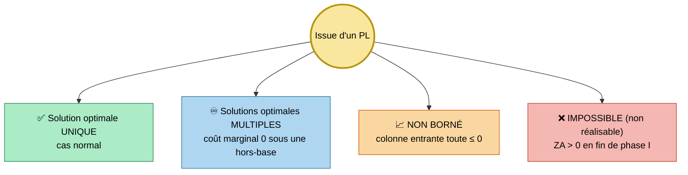

# 08 — Cas particuliers en programmation linéaire

⬅️ [[07 - Dualité]] · ➡️ [[10 - TP corrigé - Deux phases (modèle d'examen)]] · 🏠 [[00 - Accueil]]

---

| Cas | Graphiquement | Dans le tableau du simplexe |
|---|---|---|
| **Impossible** | région admissible **vide** | fin de phase I : $Z_A > 0$ (une $a_i > 0$ reste en base) |
| **Non borné** | région **ouverte** dans la direction qui améliore Z | variable entrante dont **tous** les coefficients de la colonne sont **≤ 0** → pas de rapport |
| **Solutions multiples** | droite de Z **parallèle** à une contrainte active | à l'optimum, une variable **hors base** a un coefficient **0** dans la ligne −Z (avec ratio > 0) |

---

## 1. Problème non réalisable (impossible)

> [!definition] Définition et interprétation géométrique
> La région admissible est **totalement vide** : les contraintes sont **contradictoires**, ce qui provient généralement d'une **mauvaise formulation** du problème réel.

> [!theoreme] Critère du simplexe (deux phases)
> Le modèle n'a **aucune solution admissible** si, à la **fin de la phase I**, une ou plusieurs **variables artificielles restent en base avec une valeur strictement positive** ($Z_A > 0$).

**Exemple du cours :**
$$\max Z = 3x_1 + 2x_2 \quad\text{s.c.}\quad x_1 + x_2 \le 2,\quad x_1 + x_2 \ge 4,\quad x_1,x_2\ge0$$
La somme doit être **≤ 2** et **≥ 4** en même temps : impossible.

![[graph-impossible.svg]]

**Phase I (convention TP)** — forme standard : $x_1 + x_2 + e_1 = 2$ ; $x_1 + x_2 - e_2 + a_2 = 4$.

| Base | x1 | x2 | e1 | e2 | a2 | b |
|---|---|---|---|---|---|---|
| e1 | 1 | 1 | 1 | 0 | 0 | 2 |
| a2 | 1 | 1 | 0 | −1 | 1 | 4 |
| −Z | 3 | 2 | 0 | 0 | 0 | 0 |
| ZA | **1** | 1 | 0 | −1 | 0 | 4 |

Après pivot :

| Base | x1 | x2 | e1 | e2 | a2 | b |
|---|---|---|---|---|---|---|
| x1 | 1 | 1 | 1 | 0 | 0 | 2 |
| a2 | 0 | 0 | −1 | −1 | 1 | **2** |
| −Z | 0 | −1 | −3 | 0 | 0 | −6 |
| ZA | 0 | 0 | −1 | −1 | 0 | **2** |

> [!solution] Conclusion
> Plus aucun coefficient positif dans ZA, mais $Z_A = 2 \ne 0$ (avec $a_2 = 2$ en base) ⇒ **le problème n'admet aucune solution réalisable**.

---

## 2. Problème non borné

> [!definition] Définition et interprétation géométrique
> La région admissible est **ouverte (infinie)** dans une direction qui permet d'**améliorer indéfiniment** Z ($Z \to +\infty$ en max).

> [!theoreme] Critère du simplexe
> Lors du choix de la variable entrante $x_e$, **tous les coefficients de sa colonne sont ≤ 0**. Aucune contrainte ne limite son augmentation : **le ratio minimum n'existe pas**.

**Exemple du cours :** $\max Z = x_1 + 2x_2$ s.c. $x_1 - x_2 \le 10$, $x_1, x_2 \ge 0$.
La contrainte s'écrit $x_1 \le 10 + x_2$ : si $x_2 \to +\infty$, $x_1$ peut aussi augmenter sans violer la contrainte.

![[graph-non-borne.svg]]

| Base | x1 | x2 | e1 | b | Rapport |
|---|---|---|---|---|---|
| e1 | 1 | **−1** | 1 | 10 | −1 ≤ 0 → impossible |
| −Z | 1 | **2** | 0 | 0 | |

- Variable entrante : $x_2$ (plus grand coût marginal positif +2).
- **Blocage** : le seul coefficient de $x_2$ vaut −1 ≤ 0 → le ratio $b_i / a_{i2}$ est impossible.
- **Conclusion** : aucune variable ne sort ; on **arrête** : la solution optimale est **infinie** ($Z \to +\infty$).

> [!piege] Attention
> « Non borné » **ne signifie pas** qu'il n'y a pas de solution réalisable (il y en a une infinité) ; c'est l'**optimum** qui est infini. En pratique, cela signale souvent **l'oubli d'une contrainte** lors de la modélisation.

---

## 3. Solutions optimales multiples

> [!definition] Interprétation géométrique
> Si la droite de la fonction objectif est **parallèle à une contrainte active** au sommet optimal, **tous les points du segment** ont la même valeur optimale de Z → **infinité de solutions optimales** (toutes les **combinaisons convexes** des sommets optimaux).

> [!theoreme] Condition d'unicité
> La solution optimale est **unique** si et seulement si les coûts marginaux de **toutes les variables hors base** sont **strictement différents de 0** (< 0 en max, > 0 en min).

> [!theoreme] Critère d'infinité de solutions
> Le tableau final vérifie :
> 1. la solution courante est **admissible** (artificielles nulles) ;
> 2. les coûts marginaux caractérisent l'optimalité (≤ 0 en max, ≥ 0 en min) ;
> 3. **au moins une variable hors base** (non artificielle) a un coût marginal **égal à 0**, avec une **valeur limite (ratio) > 0**.

> [!piege] Remarques sur le ratio
> - **Ratio = 0** (dégénérescence) : le pivot se fait « sur place », la solution reste **unique**.
> - **Ratio inexistant** (coefficients ≤ 0) : la variable peut croître indéfiniment avec le même Z* → l'ensemble optimal est une **demi-droite**.

**Exemple du cours :**
$$\max Z = 6x_1 + 4x_2 \quad\text{s.c.}\quad 3x_1 + 2x_2 \le 24\ (C_1),\quad x_1 + 2x_2 \le 12\ (C_2),\quad x_1,x_2\ge0$$
Les coefficients de Z (6 ; 4) sont **proportionnels** à ceux de $C_1$ (3 ; 2) → droite de Z **parallèle** à $C_1$.

![[graph-multiple.svg]]

**Tableau optimal :**

| Base | x1 | x2 | e1 | e2 | b | Rapport |
|---|---|---|---|---|---|---|
| x1 | 1 | 2/3 | 1/3 | 0 | 8 | 8 ÷ 2/3 = 12 |
| e2 | 0 | 4/3 | −1/3 | 1 | 4 | 4 ÷ 4/3 = **3** |
| −Z | 0 | 0 | −2 | 0 | −48 | |

- Sommet 1 : $(8, 0)$, $Z = 48$. Mais $x_2$ (**hors base**) a un coût marginal **nul**.
- Test du ratio : $\min(12 ; 3) = 3 > 0$ ✓.
- Pivot supplémentaire sur $x_2$ (Z ne change pas) :

| Base | x1 | x2 | e1 | e2 | b |
|---|---|---|---|---|---|
| x1 | 1 | 0 | 1/2 | −1/2 | 6 |
| x2 | 0 | 1 | −1/4 | 3/4 | 3 |
| −Z | 0 | 0 | −2 | 0 | −48 |

> [!solution] Conclusion
> Deuxième sommet optimal $(6, 3)$ : $Z = 6(6) + 4(3) = 48$. **Tout le segment $[(8,0) ; (6,3)]$ est optimal**, $Z^* = 48$.

➡️ Maintenant, l'exercice type examen : [[10 - TP corrigé - Deux phases (modèle d'examen)]]
