# 10 — TP corrigé : simplexe en deux phases ⭐ MODÈLE D'EXAMEN

🏠 [[00 - Accueil]] · 📖 Cours : [[06 - Méthode des deux phases]] · [[05 - Méthode du Simplexe]] · [[07 - Dualité]]

> [!examen] Pourquoi ce TP est le plus important
> C'est **l'exemple du type d'exercice de vendredi**. Objectif : être capable de le **refaire seul, sans erreur, en 25-30 minutes**.
> Méthode de travail : 1) lis tout une fois ; 2) cache les tableaux et refais chaque itération sur papier ; 3) compare.

---

## 📄 Énoncé

$$
\begin{cases}
\min Z = 12x_1 + 42x_2 + 20x_3\\
2x_1 + 6x_2 + 2x_3 \ge 6\\
x_1 + 3x_2 + 2x_3 \ge 4\\
x_1, x_2, x_3 \ge 0
\end{cases}
$$

> [!methode] Diagnostic avant de commencer (à faire en 10 secondes)
> - **min** → entrante = coefficient **le plus négatif** de la ligne −Z ; optimum quand tout ≥ 0.
> - Contraintes **≥** → excédents **−e** + artificielles **+a** → **deux phases**.
> - 3 variables → pas de graphique (sauf via le dual, voir la fin).

```mermaid
flowchart LR
    A["1. Forme standard<br/>−e₁+a₁, −e₂+a₂"]:::a --> B["2. ZA = a₁+a₂<br/>= 10 − 3x₁ − 9x₂ − 4x₃ + e₁ + e₂"]:::b
    B --> C["Phase I<br/>it. 1 : x₂ entre, a₁ sort<br/>it. 2 : x₃ entre, a₂ sort"]:::c
    C --> D["ZA = 0 ✅<br/>supprimer a₁, a₂, ligne ZA"]:::d
    D --> E["Phase II<br/>it. 3 : x₁ entre, x₂ sort"]:::e
    E --> F["🏁 x* = (2, 0, 1)<br/>Z min = 44"]:::f
    classDef a fill:#f9e79f,stroke:#b7950b,color:#000
    classDef b fill:#fad7a0,stroke:#d35400,color:#000
    classDef c fill:#f5cba7,stroke:#d35400,color:#000,stroke-width:2px
    classDef d fill:#d7bde2,stroke:#8e44ad,color:#000
    classDef e fill:#abebc6,stroke:#1e8449,color:#000,stroke-width:2px
    classDef f fill:#82e0aa,stroke:#1e8449,color:#000,stroke-width:3px
```

---

## 1️⃣ Mise sous forme standard

On introduit les **variables d'excédent** $e_1, e_2$ et les **variables artificielles** $a_1, a_2$ :

$$
\begin{cases}
2x_1 + 6x_2 + 2x_3 - e_1 + a_1 = 6\\
x_1 + 3x_2 + 2x_3 - e_2 + a_2 = 4\\
x_1, x_2, x_3, e_1, e_2, a_1, a_2 \ge 0
\end{cases}
$$

> [!astuce] Pourquoi ?
> - $-e_i$ : transforme le **≥** en **=** (on retire le surplus).
> - $+a_i$ : sans elle, avec $x = 0$, on aurait $-e_1 = 6$ ⇒ $e_1 = -6 < 0$ ❌. Avec elle, $a_1 = 6$ ✅ → base de départ.

**Fonction auxiliaire de la phase I :**
$$\min Z_A = a_1 + a_2$$

On l'exprime en fonction des variables **hors base** (on isole $a_1$ et $a_2$) :
$$a_1 = 6 - 2x_1 - 6x_2 - 2x_3 + e_1 \qquad a_2 = 4 - x_1 - 3x_2 - 2x_3 + e_2$$
$$\boxed{Z_A = a_1 + a_2 = 10 - 3x_1 - 9x_2 - 4x_3 + e_1 + e_2}$$

---

## 2️⃣ Première phase

Base initiale : $\{a_1, a_2\}$. Hors base : $x_1 = x_2 = x_3 = e_1 = e_2 = 0$ ⇒ $a_1 = 6$, $a_2 = 4$, $Z_A = 10$.

### Tableau initial

| Base | x1 | x2 | x3 | e1 | e2 | a1 | a2 | b | Rapport |
|---|---|---|---|---|---|---|---|---|---|
| a1 | 2 | 6 | 2 | −1 | 0 | 1 | 0 | 6 | 6/6 = **1** ✅ |
| a2 | 1 | 3 | 2 | 0 | −1 | 0 | 1 | 4 | 4/3 ≈ 1,33 |
| −Z | 12 | 42 | 20 | 0 | 0 | 0 | 0 | 0 | |
| ZA | 3 | **9** | 4 | −1 | −1 | 0 | 0 | 10 | |

> [!info] D'où viennent les lignes ?
> - **Lignes a1, a2** : les coefficients des équations standard.
> - **Ligne −Z** : les coefficients de $Z = 12x_1 + 42x_2 + 20x_3$ ; case b = 0.
> - **Ligne ZA** : **somme** des lignes a1 + a2 (sauf colonnes a1, a2 → 0) : $2+1 = 3$, $6+3 = 9$, $2+2 = 4$, $-1+0 = -1$, $0-1 = -1$, $6+4 = 10$. Ce sont les coefficients de $Z_A$ **avec le signe opposé** ($-3x_1 \to 3$, etc.) et la case b = valeur actuelle de $Z_A$ (10).

### Itération 1

- **Entrante** : dans la ligne ZA, le coefficient **positif le plus élevé** est **9** → x2 entre.
- **Rapports** : $\frac{6}{6} = 1$ ; $\frac{4}{3} = 1{,}33$. Minimum = 1 → a1 sort.
- **Pivot** = 6.

**Calculs ligne par ligne :**

| Ligne | Opération | Résultat (x1, x2, x3, e1, e2, a1, a2 \| b) |
|---|---|---|
| **x2** (pivot) | $L_{a1} \div 6$ | $\frac13,\ 1,\ \frac13,\ -\frac16,\ 0,\ \frac16,\ 0 \mid 1$ |
| **a2** | $L_{a2} - 3 \times L_{x2}$ | $1-1,\ 3-3,\ 2-1,\ 0+\frac12,\ -1,\ 0-\frac12,\ 1 \mid 4-3$ = $0,\ 0,\ 1,\ \frac12,\ -1,\ -\frac12,\ 1 \mid 1$ |
| **−Z** | $L_{-Z} - 42 \times L_{x2}$ | $12-14,\ 0,\ 20-14,\ 0+7,\ 0,\ -7,\ 0 \mid 0-42$ = $-2,\ 0,\ 6,\ 7,\ 0,\ -7,\ 0 \mid -42$ |
| **ZA** | $L_{ZA} - 9 \times L_{x2}$ | $3-3,\ 0,\ 4-3,\ -1+\frac32,\ -1,\ -\frac32,\ 0 \mid 10-9$ = $0,\ 0,\ 1,\ \frac12,\ -1,\ -\frac32,\ 0 \mid 1$ |

| Base | x1 | x2 | x3 | e1 | e2 | a1 | a2 | b | Rapport |
|---|---|---|---|---|---|---|---|---|---|
| x2 | 1/3 | 1 | 1/3 | −1/6 | 0 | 1/6 | 0 | 1 | 1 ÷ 1/3 = 3 |
| a2 | 0 | 0 | 1 | 1/2 | −1 | −1/2 | 1 | 1 | 1/1 = **1** ✅ |
| −Z | −2 | 0 | 6 | 7 | 0 | −7 | 0 | −42 | |
| ZA | 0 | 0 | **1** | 1/2 | −1 | −3/2 | 0 | 1 | |

> [!piege] Coefficients positifs de ZA : 1 (x3) et 1/2 (e1)
> Le plus élevé est **1** → $x_3$. (Ne pas regarder la colonne $a_1$ : les artificielles ne doivent jamais rentrer.)

### Itération 2

- **Entrante** : x3 (coefficient positif le plus élevé de ZA = 1).
- **Rapports** : ligne x2 : $1 \div \frac13 = 3$ ; ligne a2 : $\frac11 = 1$. Minimum = 1 → a2 sort.
  *(Le corrigé officiel n'écrit que $\frac11 = 1$, mais il faut bien comparer avec 3 : c'est plus rigoureux de les écrire tous les deux.)*
- **Pivot** = 1.

| Ligne | Opération | Résultat (x1, x2, x3, e1, e2, a1, a2 \| b) |
|---|---|---|
| **x3** (pivot) | $L_{a2} \div 1$ | $0,\ 0,\ 1,\ \frac12,\ -1,\ -\frac12,\ 1 \mid 1$ |
| **x2** | $L_{x2} - \frac13 \times L_{x3}$ | $\frac13,\ 1,\ 0,\ -\frac16-\frac16,\ 0+\frac13,\ \frac16+\frac16,\ -\frac13 \mid 1-\frac13$ = $\frac13,\ 1,\ 0,\ -\frac13,\ \frac13,\ \frac13,\ -\frac13 \mid \frac23$ |
| **−Z** | $L_{-Z} - 6 \times L_{x3}$ | $-2,\ 0,\ 0,\ 7-3,\ 0+6,\ -7+3,\ -6 \mid -42-6$ = $-2,\ 0,\ 0,\ 4,\ 6,\ -4,\ -6 \mid -48$ |
| **ZA** | $L_{ZA} - 1 \times L_{x3}$ | $0,\ 0,\ 0,\ 0,\ 0,\ -1,\ -1 \mid 0$ |

| Base | x1 | x2 | x3 | e1 | e2 | a1 | a2 | b |
|---|---|---|---|---|---|---|---|---|
| x2 | 1/3 | 1 | 0 | −1/3 | 1/3 | 1/3 | −1/3 | 2/3 |
| x3 | 0 | 0 | 1 | 1/2 | −1 | −1/2 | 1 | 1 |
| −Z | −2 | 0 | 0 | 4 | 6 | −4 | −6 | −48 |
| ZA | 0 | 0 | 0 | 0 | 0 | −1 | −1 | 0 |

> [!solution] Fin de la phase I
> $Z_A = 0$ ✅ : plus aucun coefficient positif dans ZA, les artificielles sont **hors base** (= 0).
> Les variables artificielles $a_1$ et $a_2$ peuvent être **supprimées**. La première phase est **terminée**.
> Solution réalisable trouvée : $x_1 = 0$, $x_2 = \frac23$, $x_3 = 1$ (Z = 48, pas encore optimal).

---

## 3️⃣ Deuxième phase

On **supprime les colonnes $a_1, a_2$ et la ligne ZA**, et on reprend la fonction objectif initiale $\min Z = 12x_1 + 42x_2 + 20x_3$ (sa ligne −Z est **déjà à jour**).

### Tableau initial de la phase II

| Base | x1 | x2 | x3 | e1 | e2 | b | Rapport |
|---|---|---|---|---|---|---|---|
| x2 | 1/3 | 1 | 0 | −1/3 | 1/3 | 2/3 | (2/3) ÷ (1/3) = **2** ✅ |
| x3 | 0 | 0 | 1 | 1/2 | −1 | 1 | coef 0 → ne participe pas |
| −Z | **−2** | 0 | 0 | 4 | 6 | −48 | |

### Itération 3

- **min** → coefficient **négatif** de la ligne −Z : celui de $x_1$, égal à **−2** → x1 entre.
- **Rapports** : $\frac{2/3}{1/3} = 2$. La 2ᵉ ligne **ne participe pas** (coefficient nul dans la colonne $x_1$).
- x2 sort ; **pivot** = 1/3.

| Ligne | Opération | Résultat (x1, x2, x3, e1, e2 \| b) |
|---|---|---|
| **x1** (pivot) | $L_{x2} \div \frac13 = L_{x2} \times 3$ | $1,\ 3,\ 0,\ -1,\ 1 \mid 2$ |
| **x3** | coefficient 0 → **inchangée** | $0,\ 0,\ 1,\ \frac12,\ -1 \mid 1$ |
| **−Z** | $L_{-Z} - (-2) \times L_{x1} = L_{-Z} + 2L_{x1}$ | $-2+2,\ 0+6,\ 0,\ 4-2,\ 6+2 \mid -48+4$ = $0,\ 6,\ 0,\ 2,\ 8 \mid -44$ |

### Tableau final

| Base | x1 | x2 | x3 | e1 | e2 | b |
|---|---|---|---|---|---|---|
| x1 | 1 | 3 | 0 | −1 | 1 | **2** |
| x3 | 0 | 0 | 1 | 1/2 | −1 | **1** |
| −Z | 0 | 6 | 0 | 2 | 8 | **−44** |

> [!solution] Optimalité
> Tous les coefficients de la ligne −Z sont **positifs ou nuls** (0, 6, 0, 2, 8). Pour un problème de **minimisation**, la solution obtenue est donc **optimale**.

---

## 4️⃣ Solution optimale

On lit directement dans le tableau final : variables de base $x_1 = 2$, $x_3 = 1$ ; hors base $x_2 = 0$, $e_1 = e_2 = 0$.

$$Z_{\min} = 12(2) + 42(0) + 20(1) = 24 + 20 = 44$$

(et on retrouve bien $Z = -(-44) = 44$ dans la case b de −Z ✓)

$$\boxed{x_1^* = 2,\quad x_2^* = 0,\quad x_3^* = 1,\qquad Z_{\min} = 44}$$

## 5️⃣ Vérification

- Contrainte 1 : $2(2) + 6(0) + 2(1) = 6 \ge 6$ ✓
- Contrainte 2 : $2 + 3(0) + 2(1) = 4 \ge 4$ ✓

Les deux contraintes sont vérifiées **à l'égalité** (**saturées**, $e_1 = e_2 = 0$).

---

## 🎁 Bonus : ce que l'examinateur peut demander en plus

> [!examen] Questions bonus possibles
> **a) Contraintes saturées ?** Les deux ($e_1 = e_2 = 0$).
>
> **b) Écrire le dual :**
> $$\max Z' = 6y_1 + 4y_2 \ \text{ s.c. }\ 2y_1 + y_2 \le 12,\ 6y_1 + 3y_2 \le 42,\ 2y_1 + 2y_2 \le 20,\ y_1,y_2 \ge 0$$
> **c) Solution du dual lue dans le tableau final :** sous les **excédents** $e_1, e_2$ dans la ligne −Z : $y_1^* = 2$, $y_2^* = 8$, $Z'^* = 6(2) + 4(8) = 44 = Z^*$ ✓ (dualité forte).
>
> **d) Résoudre par la dualité / graphiquement :** voir [[07 - Dualité#7. Le TP résolu par dualité ⭐]].
>
> **e) La solution est-elle unique ?** Les variables hors base $x_2, e_1, e_2$ ont des coûts marginaux **6, 2, 8 ≠ 0** → **oui, unique** ([[08 - Cas particuliers]]).

> [!info]- Même TP avec la convention du cours « −Za » (clique)
> Ligne −Za initiale : $-3,\ -9,\ -4,\ 1,\ 1,\ 0,\ 0 \mid -10$ → entrante = **le plus négatif** = −9 ($x_2$).
> Après itération 1 : $0,\ 0,\ -1,\ -\frac12,\ 1,\ \frac32,\ 0 \mid -1$ → entrante $x_3$ (−1).
> Après itération 2 : $0,\ 0,\ 0,\ 0,\ 0,\ 1,\ 1 \mid 0$ → plus de négatif, $Z_A = 0$ ✅.
> Exactement les mêmes choix de pivots, seuls les signes de cette ligne changent.

> [!methode] Check-list d'autocorrection
> - [ ] Dans chaque tableau, la colonne d'une variable de base = un **1** sur sa ligne et des **0** ailleurs (−Z et ZA compris).
> - [ ] Toutes les valeurs de **b** sont **≥ 0**.
> - [ ] ZA diminue (10 → 1 → 0) ; Z diminue en phase II (48 → 44) car c'est un min.
> - [ ] Vérification finale dans les contraintes d'origine.

➡️ Ensuite : [[11 - Exercices du cours corrigés]] puis [[12 - Exercices d'entraînement type examen]]
