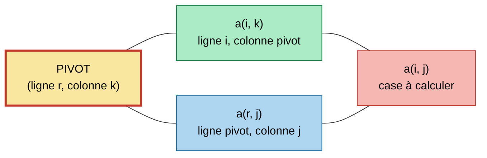

# 21 — Pièges et conventions des tableaux 🧨

🏠 [[00 - Accueil]] · 📄 [[20 - Fiche résumé]]

> [!examen] Pourquoi cette page ?
> Au simplexe, on perd rarement des points sur la méthode… on les perd sur les **signes**, les **rapports** et les **conventions**. Relis cette page la veille et le matin de l'examen.

---

## 1. Les conventions des lignes « objectif »

Le cours utilise **plusieurs écritures** pour la même chose. Voici comment ne jamais se tromper :

| Ligne | Contenu initial | Case b | Entrante | Stop |
|---|---|---|---|---|
| **−Z** (ou « MAX ») — problème **max** | coefficients $c_j$ | 0, puis **−Z** | plus grand **> 0** | tout ≤ 0 |
| **−Z** — problème **min** (TP) | coefficients $c_j$ | 0, puis **−Z** | plus **négatif** | tout ≥ 0 |
| **ZA** (TP, phase I) | somme des lignes artificielles | $+Z_A$ | plus grand **> 0** | plus de > 0 |
| **−Za** (cours, phase I) | opposé de la somme | $-Z_A$ | plus **négatif** | plus de < 0 |
| **Z'** (cours, dualité, tableau optimal) | affiché en **valeurs positives** | $+Z'$ | — | — |

> [!piege] Valeur de Z
> La case b de la ligne −Z contient **−Z**. Si tu lis −44, alors **Z = 44**. Recalcule toujours Z avec la fonction objectif d'origine pour vérifier.

## 2. Test du rapport

> [!piege] Les 4 règles
> 1. Rapport = $\dfrac{b_i}{\text{coef dans la colonne entrante}}$.
> 2. **Uniquement si le coefficient est strictement positif.** 0 ou négatif → la ligne est ignorée.
> 3. On prend le **plus petit** rapport (≥ 0). Un rapport de **0** est valide (dégénérescence).
> 4. Aucun coefficient > 0 → **non borné**, on arrête.

## 3. Erreurs de calcul fréquentes

> [!piege] Liste noire
> - ❌ Oublier de mettre à jour la ligne **−Z** pendant la **phase I** → la phase II démarre faux.
> - ❌ Oublier de mettre à jour la **case b** de −Z ou de ZA.
> - ❌ Soustraire avec l'**ancienne** ligne pivot au lieu de la **nouvelle** (divisée par le pivot) — ou alors utiliser la formule du cours $L - \frac{A}{\text{pivot}} \times L_{\text{ancienne}}$, mais pas un mélange des deux.
> - ❌ $L - (-2)\times L_p$ : moins par moins = **plus** (itération 3 du TP).
> - ❌ Choisir une **artificielle** comme variable entrante.
> - ❌ Signes de $e_i$ : **+** pour ≤, **−** pour ≥.
> - ❌ En min, prendre le plus grand positif (réflexe du max).
> - ❌ Dans la ligne ZA, oublier le **−1** des excédents.
> - ❌ Fractions : $\frac{2/3}{1/3} = 2$ ; $1 \div \frac13 = 3$ ; $-\frac16 - \frac16 = -\frac13$.

## 4. Contrôles automatiques (10 secondes par tableau)

> [!methode] Après chaque pivot
> - [ ] Colonne de chaque variable de base = vecteur unité (**1** sur sa ligne, **0** partout ailleurs, lignes objectif comprises).
> - [ ] Tous les **b ≥ 0**.
> - [ ] Z (ou $Z_A$) a évolué dans le **bon sens** (ou est resté égal si rapport 0).
> - [ ] Autant de variables de base que de contraintes.

## 5. Égalité de rapports ou de coefficients

> [!astuce] Que faire ?
> - **Deux coefficients égaux pour l'entrante** : prends n'importe lequel (le cours prend le premier, ex. $x_1$ dans l'exemple des deux phases). Écris « par convention, on choisit la première ».
> - **Deux rapports égaux pour la sortante** : prends n'importe lequel ; une variable de base vaudra 0 (solution **dégénérée**). Ce n'est **pas une erreur**.

## 6. Méthode du rectangle (vérification rapide d'une case)

$$\text{nouveau} = \text{ancien} - \frac{(\text{même ligne, colonne pivot}) \times (\text{ligne pivot, même colonne})}{\text{pivot}}$$

Exemple (TP, it. 1, case −Z / $x_1$) : $12 - \dfrac{42 \times 2}{6} = 12 - 14 = -2$ ✓

