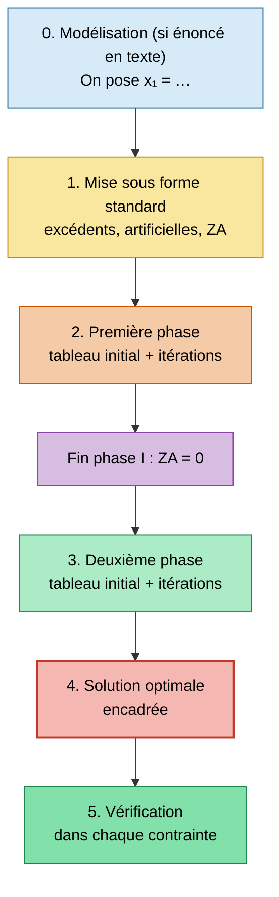

# 22 — Modèle de rédaction pour l'examen 📋

🏠 [[00 - Accueil]] · ⭐ [[10 - TP corrigé - Deux phases (modèle d'examen)]]

> [!examen] Principe
> Le correcteur note la **démarche** autant que le résultat. Reprends **la structure du corrigé du TP** (mêmes titres, mêmes phrases) : c'est le format que le prof attend.

---

## Squelette de copie (deux phases)

### 0. Modélisation (si l'exercice est un texte)
> « Soit $x_1$ la quantité de … (en …), $x_2$ … »
> « L'objectif est de minimiser/maximiser … : $\min Z = …$ »
> « Les contraintes sont : … (contrainte de …) »
> « Contraintes de non-négativité : $x_1, x_2 \ge 0$. »

### 1. Mise sous forme standard
> « On introduit les variables d'excédent $e_1, e_2$ et les variables artificielles $a_1, a_2$ : (système) »
> « La fonction auxiliaire de la première phase est : $\min Z_A = a_1 + a_2$. »
> « $Z_A = a_1 + a_2 = … $ » (exprimée en fonction des variables hors base)

### 2. Première phase
> « La base initiale est $\{a_1, a_2\}$. Le tableau initial est : » (tableau)
> **Pour chaque itération :**
> « **Itération k.** Dans la ligne $Z_A$, le coefficient positif le plus élevé est … La variable … entre donc dans la base. »
> « Calcul des rapports : … Le rapport minimal est … La variable … sort de la base et le pivot est égal à … »
> « Après pivot, on obtient : » (tableau)
>
> « On obtient $Z_A = 0$. Les variables artificielles peuvent donc être supprimées. La première phase est terminée. »

### 3. Deuxième phase
> « On supprime les colonnes des variables artificielles ainsi que la ligne $Z_A$, puis on reprend la fonction objectif initiale. Le tableau initial de la deuxième phase est : »
> « **Itération k.** Dans la ligne −Z, le coefficient négatif (min) / positif le plus grand (max) est celui de …, égal à … La variable … entre. »
> « La ligne … ne participe pas au test des rapports car son coefficient dans la colonne de … est nul/négatif. »
> « Tous les coefficients de la ligne −Z sont positifs ou nuls (min) / négatifs ou nuls (max). La solution obtenue est donc optimale. »

### 4. Solution optimale
> « On lit directement dans le tableau final : $x_1 = …$, $x_2 = …$ »
> « La valeur optimale est $Z = …$ (calcul détaillé) »
> $\boxed{x^* = (…),\ Z^* = …}$

### 5. Vérification
> « Pour la première contrainte : … = … ✓ » (pour **chaque** contrainte)
> « Les contraintes … sont saturées / la contrainte … a un surplus de … »

---

> [!astuce] Présentation des tableaux sur papier
> - Règle pour tracer les tableaux, **encadre le pivot**, **flèche** sur la colonne entrante et la ligne sortante (comme les couleurs du cours).
> - Ajoute une colonne « **Rapport** » à droite de b.
> - Écris les **opérations sur les lignes** à côté ($L_2 \leftarrow L_2 - 3L_1$) : même en cas d'erreur de calcul, la méthode est visible.
> - Garde les **fractions** (pas de décimales arrondies !).

> [!piege] Gestion du temps
> Si tu bloques sur un calcul, **ne recommence pas tout** : vérifie la ligne avec le contrôle « colonne de base = 1 et 0 », puis continue. Une itération juste avec une petite erreur arithmétique rapporte encore beaucoup de points.

> [!examen] Si on te demande en plus…
> - **Le dual** → [[07 - Dualité]] (transposer, inverser max/min et ≤/≥).
> - **La solution du dual** → lire sous les colonnes $e_i$ de la ligne −Z finale.
> - **Contraintes saturées** → écarts/excédents nuls.
> - **Unicité** → coefficients des hors-base ≠ 0 dans −Z finale.
> - **Méthode graphique** (2 variables) → sommets + tableau des valeurs de Z.
