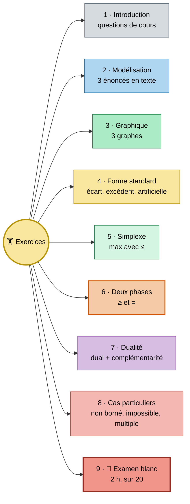

# 🏋️ Exercices — salle d'entraînement

🏠 [[00 - Accueil]] · 📄 [[20 - Fiche résumé]] · 🧨 [[21 - Pièges et conventions des tableaux]]

> [!examen] Comment utiliser cette section
> - **3 exercices par partie du cours**, du plus simple au plus proche de l'examen, + un **examen blanc** complet.
> - Les corrections sont **repliées** : fais l'exercice **sur papier** d'abord, puis clique sur « ✅ Correction ».
> - Toutes les solutions ont été **vérifiées par calcul exact** (fractions).
> - Coche la case quand l'exercice est réussi **sans regarder la correction**.

## 📋 Suivi de progression

| Partie | Exercices | Cours associé |
|---|---|---|
| 1 | [[Ex 1 - Introduction]] | [[01 - Introduction à la RO]] |
| 2 | [[Ex 2 - Modélisation]] | [[02 - Modélisation d'un PL]] |
| 3 | [[Ex 3 - Résolution graphique]] | [[03 - Résolution graphique]] |
| 4 | [[Ex 4 - Forme standard]] | [[04 - Formes canonique et standard]] |
| 5 | [[Ex 5 - Simplexe]] | [[05 - Méthode du Simplexe]] |
| 6 | [[Ex 6 - Deux phases]] ⭐ | [[06 - Méthode des deux phases]] |
| 7 | [[Ex 7 - Dualité]] | [[07 - Dualité]] |
| 8 | [[Ex 8 - Cas particuliers]] | [[08 - Cas particuliers]] |
| 9 | [[Ex 9 - Examen blanc]] 📝 | tout le cours |

### Ma checklist
- [ ] Introduction : 1 · 2 · 3
- [ ] Modélisation : 1 · 2 · 3
- [ ] Graphique : 1 · 2 · 3
- [ ] Forme standard : 1 · 2 · 3
- [ ] Simplexe : 1 · 2 · 3
- [ ] Deux phases : 1 · 2 · 3
- [ ] Dualité : 1 · 2 · 3
- [ ] Cas particuliers : 1 · 2 · 3
- [ ] Examen blanc en 2 h → note : ___ / 20

> [!astuce] Ordre conseillé si tu manques de temps
> **6 (deux phases)** → **5 (simplexe)** → **9 (examen blanc)** → 7 → 2 → 3 → 8 → 4 → 1.
> Les exercices du cours et du TP sont aussi dans [[11 - Exercices du cours corrigés]] et [[12 - Exercices d'entraînement type examen]].
