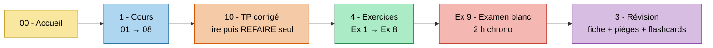

# 📘 Recherche Opérationnelle — Vault de révision (Programmation linéaire)

Un **vault Obsidian** complet pour réviser la **Recherche Opérationnelle** (EMSI · 4IIR) : cours réorganisé et expliqué, TP corrigé pas à pas, exercices corrigés pour chaque chapitre et un examen blanc sur 20.

Tout est en **français**, avec des **schémas colorés**, des **graphiques** pour la méthode graphique et des **tableaux du simplexe détaillés** (choix du pivot, opérations sur les lignes, vérifications).

> [!NOTE]
> Ce vault est un **support de révision personnel** construit à partir du cours. Ce n'est **pas** un document officiel : en cas de doute, c'est le cours et les consignes du professeur qui font foi.

---

## 📑 Sommaire

- [Ce que contient le vault](#-ce-que-contient-le-vault)
- [Installation (5 minutes)](#-installation-5-minutes)
- [Comment l'utiliser pour réviser](#-comment-lutiliser-pour-réviser)
- [Conventions utilisées dans les tableaux](#-conventions-utilisées-dans-les-tableaux)
- [Lire le vault sans Obsidian (GitHub)](#-lire-le-vault-sans-obsidian-github)
- [Signaler une erreur / contribuer](#-signaler-une-erreur--contribuer)

---

## 📂 Ce que contient le vault

```
📁 (racine du vault)
├── 00 - Accueil.md                  ← POINT DE DÉPART : carte du cours, arbre de décision, plan de révision
│
├── 📁 1 - Cours/                     ← le cours, chapitre par chapitre
│   ├── 01 - Introduction à la RO
│   ├── 02 - Modélisation d'un PL
│   ├── 03 - Résolution graphique
│   ├── 04 - Formes canonique et standard
│   ├── 05 - Méthode du Simplexe
│   ├── 06 - Méthode des deux phases      ⭐
│   ├── 07 - Dualité
│   └── 08 - Cas particuliers
│
├── 📁 2 - TP et Exercices/
│   ├── 10 - TP corrigé - Deux phases (modèle d'examen)   ⭐ le plus important
│   ├── 11 - Exercices du cours corrigés
│   └── 12 - Exercices d'entraînement type examen
│
├── 📁 3 - Révision/
│   ├── 20 - Fiche résumé                 ← tout le cours sur une page
│   ├── 21 - Pièges et conventions des tableaux
│   ├── 22 - Modèle de rédaction pour l'examen
│   └── 23 - Questions de cours (flashcards)
│
├── 📁 4 - Exercices/                 ← salle d'entraînement
│   ├── Exercices                         ← hub + suivi de progression
│   ├── Ex 1 - Introduction … Ex 8 - Cas particuliers   (3 exercices corrigés par partie)
│   └── Ex 9 - Examen blanc               ← 2 h, barème sur 20
│
├── 📁 Images/                        ← graphiques SVG (méthode graphique, dualité, cas particuliers)
└── 📁 .obsidian/                     ← thème coloré (snippet CSS) + couleurs du graphe
```

| Partie | Ce que tu y trouves |
|---|---|
| **Cours** | Définitions, théorèmes, méthodes en étapes, exemples du cours entièrement résolus, schémas colorés |
| **TP corrigé** | Chaque itération expliquée : pourquoi telle variable entre/sort, calcul de chaque ligne, vérification, lien avec la dualité |
| **Exercices** | 24 exercices (3 par chapitre) + examen blanc, corrections **cachées** à déplier après avoir cherché |
| **Révision** | Fiche résumé, liste des pièges, modèle de copie, flashcards de questions de cours |

Toutes les solutions numériques (tableaux, optimums) ont été **vérifiées par un calcul exact en fractions**.

---

## ⚙️ Installation (5 minutes)

### 1. Récupérer le vault
- **Avec Git** :
  ```bash
  git clone <URL-du-repo>
  ```
- **Sans Git** : bouton vert **Code → Download ZIP** sur GitHub, puis décompresser.

### 2. Installer Obsidian
Gratuit : <https://obsidian.md> (Windows, macOS, Linux, Android, iOS).

### 3. Ouvrir le dossier comme vault
Obsidian → **Open folder as vault** (« Ouvrir un dossier comme coffre ») → sélectionner le dossier cloné/décompressé (celui qui contient ce `README.md`).

### 4. Activer le thème coloré
Normalement il s'active tout seul. Sinon :
**Paramètres → Apparence → Extraits CSS (CSS snippets)** → activer **`ro-couleurs`**.

Tu dois voir : titres colorés, encadrés colorés (Définition, Méthode, Piège, Examen…), pivots surlignés en jaune dans les tableaux.

> [!TIP]
> Aucun plugin communautaire n'est nécessaire : formules (LaTeX), schémas (Mermaid) et encadrés (callouts) sont gérés nativement par Obsidian.

### 5. Commencer
Ouvre **`00 - Accueil`**. Tout part de là.

---

## 🎯 Comment l'utiliser pour réviser

### Parcours recommandé



1. **Comprendre** : lis les chapitres de `1 - Cours` dans l'ordre. Chaque note a des liens ⬅️ / ➡️ pour passer à la suivante.
2. **Maîtriser le modèle d'examen** : lis `10 - TP corrigé`, puis **cache-le** et refais-le **sur papier** jusqu'à ne plus faire d'erreur.
3. **S'entraîner** : ouvre la note `Exercices` et fais les exercices partie par partie.
4. **Se tester** : fais `Ex 9 - Examen blanc` en **2 heures**, sans notes, puis corrige-toi avec le barème.
5. **Réviser la veille** : `20 - Fiche résumé`, `21 - Pièges`, `23 - Flashcards`.

> **Peu de temps ?** Priorité : *Deux phases* → *Simplexe* → *Examen blanc* → *Dualité* → le reste.

### Comment marchent les exercices
- L'énoncé est visible, la **correction est repliée** : clique sur « ✅ Correction » pour la déplier **après** avoir cherché.
- Fais les calculs **sur papier** avec des **fractions** (pas de décimales arrondies), comme le jour de l'examen.
- Coche ta progression dans la checklist de la note `Exercices`.

### Les couleurs dans les tableaux du simplexe
| Marque | Signification |
|---|---|
| 🟩 fond vert | variable **entrante** (colonne pivot) |
| 🟥 fond rouge | variable **sortante** (ligne pivot) |
| 🟨 jaune encadré | **pivot** |
| 🟦 fond bleu | valeur importante (optimum, solution du dual…) |

### Astuces Obsidian utiles
- **Vue graphe** (`Ctrl/Cmd + G`) : les notes sont colorées par partie (cours, TP, révision, exercices).
- **Recherche** (`Ctrl/Cmd + Shift + F`) : chercher « pivot », « dualité », « non borné »…
- **Ctrl/Cmd + clic** sur un lien pour l'ouvrir dans un nouvel onglet (pratique pour garder le cours à côté d'un exercice).

---

## 📏 Conventions utilisées dans les tableaux

Le vault suit les conventions du **corrigé du TP** :

| Ligne | Contenu | Variable entrante | Optimum atteint quand |
|---|---|---|---|
| **−Z** (problème **max**) | coefficients $c_j$, case b = −Z | plus grand coefficient **> 0** | tous **≤ 0** |
| **−Z** (problème **min**) | coefficients $c_j$, case b = −Z | coefficient **le plus négatif** | tous **≥ 0** |
| **ZA** (phase I) | somme des lignes contenant une artificielle | plus grand coefficient **> 0** | plus aucun > 0 et $Z_A = 0$ |

- Variable sortante : **plus petit rapport** $b_i / a_{ik}$, uniquement pour $a_{ik} > 0$.
- Valeur de l'objectif : $Z = -(\text{case b de la ligne }-Z)$.
- Les diapos du cours écrivent parfois la ligne de phase I sous la forme **−Za** (signes opposés, on choisit alors le plus négatif) : c'est **équivalent**, la note `06 - Méthode des deux phases` montre les deux.

---

## 🌐 Lire le vault sans Obsidian (GitHub)

Le vault est pensé pour **Obsidian**. Sur GitHub, les fichiers `.md` s'affichent, mais :

| Élément | Sur GitHub |
|---|---|
| Formules LaTeX, schémas Mermaid | ✅ affichés |
| Liens entre notes `[[...]]` | ❌ non cliquables |
| Images `![[graph.svg]]` | ❌ non affichées (ouvre le dossier `Images/`) |
| Encadrés colorés et corrections repliables | ❌ affichés comme de simples citations |
| Couleurs du thème | ❌ |

👉 Pour en profiter pleinement : **télécharge le repo et ouvre-le dans Obsidian**.

Accès direct aux notes principales : [Accueil](00%20-%20Accueil.md) · [TP corrigé](2%20-%20TP%20et%20Exercices/10%20-%20TP%20corrig%C3%A9%20-%20Deux%20phases%20%28mod%C3%A8le%20d%27examen%29.md) · [Exercices](4%20-%20Exercices/Exercices.md) · [Examen blanc](4%20-%20Exercices/Ex%209%20-%20Examen%20blanc.md) · [Fiche résumé](3%20-%20R%C3%A9vision/20%20-%20Fiche%20r%C3%A9sum%C3%A9.md)

---

## 🛠️ Signaler une erreur / contribuer

Tu as trouvé une erreur de calcul, une coquille ou une explication pas claire ?
- Ouvre une **Issue** sur le repo en indiquant la **note**, l'**exercice** et la **ligne du tableau** concernés ;
- ou propose directement la correction via une **Pull Request**.

Idées de contributions bienvenues : nouveaux exercices corrigés, chapitre sur la **théorie des graphes** et les **plus courts chemins** (prévus dans le plan du cours, pas encore couverts ici).

---

## ⚠️ Avertissement

- Contenu couvert : **programmation linéaire** (modélisation, graphique, simplexe, deux phases, dualité, cas particuliers). La partie graphes du plan général n'est **pas** incluse.
- Les **PDF originaux du cours ne sont pas inclus** dans ce repo : demande-les à ton professeur ou sur la plateforme de l'école.
- Les exercices « d'entraînement » et l'examen blanc sont des **exercices inventés dans l'esprit du TP**, pas des sujets officiels.

Bonne révision et bon courage pour l'examen ! 💪
